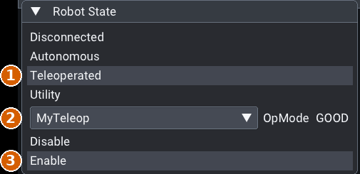

# Lesson 0 — Orientation: run the robot and print a message

**Goal:** Get the template building and running in simulation, understand how
the pieces fit together, and make your first code change — printing a
message the moment your robot's teleop code wakes up.

**New Java concepts**
- What a **class**, **package**, and **method** are
- **Statements** and the semicolon
- **Annotations** — a tag above a class that tells a framework something
  about it
- Calling a method (`System.out.println(...)`)

**New robot concepts**
- **Opmodes** — named, selectable pieces of robot behavior
- The **opmode loop** — the heartbeat inside whichever opmode is selected

---

## 1. What am I even looking at?

Open `src/main/java/first/robot/` and you'll find three files. <!-- claim: wpilib.opmode-template-files -->

```
first/
├── Main.java              ← JVM entry point. Never touch it.
└── robot/
    ├── Robot.java          ← Boots the framework. You'll rarely touch it.
    └── opmode/
        ├── MyTeleop.java   ← What the robot does when you drive it.
        └── MyAuto.java     ← What the robot does on its own, in autonomous.
```

That's totally normal to find unfamiliar — half of it won't matter for a
while. Read the comments once, let the picture settle (boot, then hand off
to whichever opmode is picked), and keep going.

### Classes and packages

Open `Robot.java` and look at the first real line.

*Nothing to add — this is code you already have:*

```java
package first.robot;
```

That's a **package** declaration. Packages keep class names from colliding
across libraries — if two vendors both shipped a `Timer` class, packages are
how you'd tell them apart. Here the packages just mirror the folder
structure: `first.robot` is the folder `first/robot`, opmodes live in
`first.robot.opmode`. One rule to remember: **the package at the top of a
file has to match its folder path.**

Below the package line, every file defines a **class** — a blueprint.
`Robot` is the class the whole program boots from. `MyTeleop` and `MyAuto`
are opmodes, and every mechanism or command you write from Lesson 1 on gets
its own class too.

### Methods, and a tag sitting above one of them

Inside a class, the code that actually runs lives in **methods** — named
blocks of code that *do* something. Open `MyTeleop.java`.

*Nothing to add — this is code you already have:*

```java
@Teleop
public class MyTeleop extends PeriodicOpMode {
  private final Robot robot;

  public MyTeleop(Robot robot) {
    this.robot = robot;
  }

  @Override
  public void disabledPeriodic() {
    /* Called periodically (on every DS packet) while the robot is disabled. */
  }

  @Override
  public void start() {
    /* Called once when the robot is enabled. */
  }

  @Override
  public void periodic() {
    /* Called periodically (set time interval) while the robot is enabled. */
  }

  @Override
  public void end() {
    /* Called when the robot is disabled (after previously being enabled). */
  }

  @Override
  public void close() {
    /* Called when the opmode is de-selected / no additional methods will be called. */
  }
}
```

Five methods, all currently empty, each named after the moment it fires. <!-- claim: wpilib.opmode-template-files, wpilib.opmode-lifecycle -->
The one to focus on today is `periodic()` — you'll meet the others as you
need them. Like every method WPILib calls for you, you don't call
`periodic()` yourself. The framework does, on its own schedule. The
`@Override` next to it means what it always will in this course: "yes, I
know this method already has a meaning; I'm supplying my own."

The `@Teleop` sitting *above* the whole class is a different kind of thing:
an **annotation** — a tag that tells the framework something about the class
underneath it, without being a method or a field itself. `@Teleop` says
"this is a piece of robot behavior a human can pick on the Driver Station,
and list it by its class name, `MyTeleop`, unless told otherwise." <!-- claim: wpilib.opmode-annotation-class-name --> `MyAuto.java` has the same
idea with `@Autonomous` instead. Neither annotation runs any code by
itself — it's a label the framework reads before your code ever executes.

That's the biggest mental shift in this lesson, worth saying plainly: **you
don't write one robot program that runs top to bottom. You write several
small ones — opmodes — and something else decides which one is running right
now.** Which brings us to…

---

## 2. Opmodes and the heartbeat

An **opmode** is a named, selectable chunk of robot behavior. `MyTeleop` and
`MyAuto` are both opmodes, and a human picks one by name on the Driver
Station before anything in it runs.

Once an opmode is picked and the robot is enabled, its `periodic()` method
runs **about 50 times a second**, forever, until something else is picked or
the robot disables. Each run is a **tick**. That's the heartbeat — the same
idea as always: a fast loop, ticking away, doing a little work each time. <!-- claim: wpilib.opmode-periodic-20ms -->
You never write `while (true)` yourself; the framework is the loop, and you
plug things into it. If you take one thing from this lesson, take that
picture, with one layer added: *which* piece of code the framework is
ticking depends on what's selected.

Figure 0.1 shows when each of the five methods from section 1 fires. Read
it left to right, like a timeline. Picking the opmode runs its **constructor**
(`MyTeleop(robot)`), once. While the robot is disabled the opmode sits there
ticking `disabledPeriodic()`. **Enable** runs `start()` once, and then
`periodic()` ticks about every 20 ms for as long as you stay enabled.
**Disable** runs `end()` and then `close()`, and that opmode is finished: the
framework builds a fresh one straight away (its constructor runs again), and
the new one ticks `disabledPeriodic()` until you enable. Picking a different
opmode runs `close()` too. (The template's comment on `close()` only mentions
de-selecting; disabling counts as well.) Each method fires at one moment, and
only the two `periodic` ones repeat. <!-- claim: wpilib.opmode-lifecycle, wpilib.opmode-periodic-20ms -->

<a id="figure-0-1"></a>


*Figure 0.1 — An opmode's life: constructor, `start()`, a row of `periodic()` ticks, then `end()` and `close()`, and a fresh opmode takes its place.* <!-- claim: wpilib.opmode-lifecycle -->

---

## 3. Run it

Time to see it. Either:
1. Click the **WPILib icon** in VS Code's left sidebar (or open the command
   palette with Ctrl+Shift+P → **WPILib: Simulate Robot Code**), or
2. From the project folder in PowerShell:

**Run:**

```powershell
./gradlew run
```

The very first run downloads a pile of dependencies and can take several
minutes. Grab a drink.

If you started it from VS Code, it asks when the build finishes whether you
want Sim GUI and/or Real Driverstation. **Sim GUI** is correct for now. <!-- claim: wpilib-tools.vscode-simulate-and-vendor-manager -->
From the terminal, the SimGUI window just opens. When it does: <!-- claim: gradlerio.run-starts-simgui -->

The panel you want is **Robot State**, in the top left, and it holds
everything you need. It's three steps, top to bottom, and Figure 0.2 numbers
them:

1. Click **Teleoperated** in the list of modes. The panel starts on
   *Disconnected*: the simulated Driver Station isn't attached yet, and
   picking a mode attaches it. <!-- claim: wpilib-tools.simgui-robot-state-panel -->
2. Open the **OpMode** drop-down underneath and pick **MyTeleop**. That's the
   **opmode selector**. It only lists opmodes of the mode you picked, which is
   why step 1 comes first. (`MyAuto` shows up under **Autonomous**.) <!-- claim: wpilib-tools.simgui-robot-state-panel, wpilib.opmode-annotation-class-name -->
3. Click **Enable**. The robot is now running `MyTeleop`.

<a id="figure-0-2"></a>


*Figure 0.2 — SimGUI's Robot State panel: (1) pick the mode, (2) pick the opmode, (3) enable.* <!-- claim: wpilib-tools.simgui-robot-state-panel -->

Congratulations — you're "driving" a simulated robot. Nothing moves,
because there's no motor yet. That's Lesson 1.

Close the window (or hit `Ctrl+C` in the terminal) when you're done.

**From here on, a lesson just says "run the robot in simulation."** That
means either of the two ways above. Use whichever you like; most people
end up clicking the button in VS Code.

---

## 4. Your first change: say hello

Let's prove that when you edit code, the robot notices.

**Back in `MyTeleop.java`, find `start()` and drop this line into it:**

```java
@Override
public void start() {
  System.out.println("Hello from Team 5010! Teleop started.");
}
```

`start()` runs exactly once — the instant your opmode goes from disabled to
enabled. <!-- claim: wpilib.opmode-lifecycle --> That makes it a better home for a one-time message than
`periodic()`, which would print the same line fifty times a second and flood
your terminal.

Small line, three things worth naming. `System.out.println(...)` is a
**method call** — we're asking a method to run and handing it something in
the parentheses. The stuff in `"double quotes"` is a **String**, Java's word
for a chunk of literal text. And the whole line ends in a **semicolon**.
Every statement in Java does. Forgetting the semicolon is the number-one
beginner compile error — better to meet the error message now than be
surprised by it later.

Run the robot in simulation again, pick **Teleoperated** and **MyTeleop**
the way Figure 0.2 shows, click **Enable**, and glance at the terminal. Your
message should be sitting right there. You just changed what the robot does.

---

## Try it

Two quick exercises before you move on. Don't skip them — most of the actual
learning happens when you have to think, not when you're copying code out of
the walkthrough.

1. **Code — give `MyAuto` a `start()`.** Open `MyAuto.java`. It doesn't have
   a `start()` method yet — add one, matching the shape `MyTeleop`'s already
   has, and print a *different* message from it. Verify it only shows up
   when you've picked **Autonomous** and **MyAuto**, not **Teleoperated** and
   **MyTeleop**.
2. Break it on purpose. Delete a semicolon and run `./gradlew build`. Read
   the error carefully — note the file it points at and the line number it
   gives you. Reading compiler errors is a real skill, and the sooner you're
   comfortable with them the better. Put the semicolon back when you're
   done.

---

## What you learned

A robot program here is a stack of **classes** in **packages**, same as
always — but now some of those classes are **opmodes**, tagged with an
**annotation** like `@Teleop` so the framework can find them and offer them
by name on the Driver Station. Whichever opmode gets picked is the one whose
`periodic()` starts ticking about 50 times a second — that's still the
heartbeat everything else in this course hangs off, just with one more
layer: which piece of code the heartbeat is driving is now a choice made at
runtime, not baked into a single class. <!-- claim: wpilib.opmode-periodic-20ms --> That's plenty for one sitting.

Next: Lesson 1 — Your first motor.
