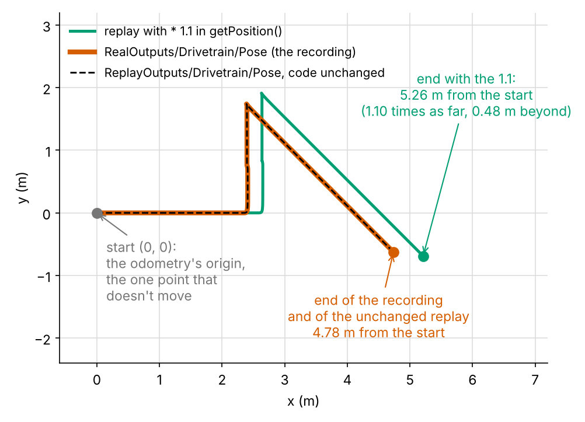

# Lesson 13 — IO layers & replay: logs that drive the robot

**Goal:** Restructure the drivetrain so every sensor reading enters through
one clearly named door — a **ModuleIO** and a **GyroIO** — with a separate
class behind that door for real hardware and for simulation, chosen
automatically by a `Constants.Mode` switch. Then let **AdvantageKit**
record everything that comes through those doors, and play a recorded run
back through your code, including code you changed after the run.

**New Java concepts**
- **Interfaces** and **default methods** — a contract with optional homework
- **Anonymous classes** — `new ModuleIO() {}`, a nameless do-nothing implementation
- **Enums** — a type with a fixed menu of values (`REAL`, `SIM`, `REPLAY`)
- **Subclassing your own class** — `extends`, `protected`, and `super`
- **`switch` expressions** — one arm per enum value, checked by the compiler
- **Annotations that write code** — `@AutoLog` makes a class for you as the project compiles
- **Initializer blocks** — a bare `{ }` in a class, run while the object is built

**New robot concepts**
- **Inputs vs. outputs** — sensor readings come *in*, computed values go *out*
- The **IO layer** — hardware behind an interface, swappable per mode
- **AdvantageKit** — a logger that records every input, so a run can be replayed
- **Replay** — running a recorded run back through your code, changed or not

---

## 1. The idea: hardware behind a door

Since Lesson 4, `SwerveModule` has done two jobs at once. It *is* the
hardware — it owns the TalonFXs and the CANcoder — and it's also the logic
that decides what to command them to do. You've been keeping those jobs
straight by hand: `simulatePeriodic()` sits right next to the real control
code, and you trust yourself to only call it when simulating. That's worked
for twelve lessons. It also means every sensor reading could, in principle,
come from three different places — a real motor, a physics model, or (an
idea worth planting now) a recorded log — and nothing in the code says so.

This lesson draws a hard line instead. One **interface** describes every
sensor reading and every command a module's hardware can perform. One
**implementation class per world** sits behind it — real hardware for the
real robot, a physics model for the simulator. `SwerveModule` stops owning
a single motor. It owns an interface reference, and it has no idea — and no
need to know — which world is on the other end.

Here's why that's worth the ceremony, beyond tidiness. If hardware only
ever enters your code through one door per sensor, that door is the *only*
place anything would ever need to intercept a reading — to log it, to fake
it for a test, or to hand it a value read back out of a recorded match
instead of a live sensor. That last one is the biggest idea in this
lesson. By the end you'll record a drive in the simulator, then run it
again with no simulator and no hardware at all: every reading comes out of
the file, and your code works out everything else from scratch. Change the
code first, and the replay shows you what the robot *would* have done.

Figure 13.1 is the map for the rest of the lesson.

<a id="figure-13-1"></a>
![A map of the IO layer. On the left, SwerveModule holds a ModuleIO and its inputs bundle and owns no motors. In the middle, the ModuleIO interface has two lists: inputs, the readings steerAngleDegrees, drivePositionMeters and driveVelocityMetersPerSec filled by updateInputs, and commands, setSteerAngleDegrees and setDriveVelocityMetersPerSec. On the right, ModuleIOTalonFX for the real robot, ModuleIOSim for simulation and an empty ModuleIO for replay, one of which Drivetrain's makeModule switch picks. Below, a smaller copy of the same shape for the gyro: GyroIO with GyroIOPigeon2, GyroIOSim and an empty GyroIO.](images/13-io-door.svg)

*Figure 13.1 — One door per sensor: the logic on one side, three things that can stand on the other.*

Start on the left: `SwerveModule` is the logic, and the only thing it
knows about hardware is the interface box in the middle, `ModuleIO`. That
interface has just two kinds of member. One is the readings that come
*in*: a bundle of three numbers that `updateInputs` fills. The other is the
commands that go *out*: steer here, drive that fast. On the right are the
things that can stand behind the door (the real motors, the physics model,
or nothing at all for a replay), and the purple box at the top is where
`Drivetrain` picks one, once, when the robot is built. The lower half of the
figure is the same shape again for the gyro, in section 8. You'll
recognize it every time it comes back: in later lessons the camera, the
elevator and the other mechanisms each get their own door like this one.

---

## 2. Install AdvantageKit

Replay needs a logger built for it, and the one this course uses is
**AdvantageKit**. Its job is narrow and strict: record every reading the
robot takes, in order, every tick, so the run can be fed back through the
code later. It's a vendor library, installed the same way as Phoenix 6 in
Lesson 1.

**Install it:**

1. Open the vendor dependency manager: the **WPILib icon** in VS Code's
   left sidebar, or Ctrl+Shift+P → **WPILib: Manage Vendor Libraries**.
2. In the list of available dependencies, find **AdvantageKit** and
   install it.

A new file, `vendordeps/AdvantageKit.json`, appears. <!-- claim: advantagekit.vendordep-installs -->

Lesson 1 told you that you never edit `build.gradle` for a vendor library,
and for almost all of them that's true. AdvantageKit is the exception,
because part of it runs while your code *compiles*, writing code for you.
You'll see what it writes in the next section. Gradle has to be told to
run it, and that takes two edits to `build.gradle`, the file at the top of
your project folder, beside `vendordeps/`.

**Add to the very bottom of `build.gradle`:**

```groovy
// AdvantageKit (Lesson 13). @AutoLog writes each inputs class's logging code
// while the project compiles; replayWatch replays a log again every time you
// save a change.
task(replayWatch, type: JavaExec) {
    mainClass = "org.littletonrobotics.junction.ReplayWatch"
    classpath = sourceSets.main.runtimeClasspath
}

dependencies {
    def akitJson = new groovy.json.JsonSlurper().parseText(new File(projectDir.getAbsolutePath() + "/vendordeps/AdvantageKit.json").text)
    annotationProcessor "org.littletonrobotics.akit:akit-autolog:$akitJson.version"
}
```

The file already has a `dependencies` block higher up; a second one adds
to it rather than replacing it. The `annotationProcessor` line is the
compile-time part, and the line above it reads AdvantageKit's version out
of the vendordep file, so the two can never disagree. `replayWatch` is a
shortcut you'll meet in section 11. <!-- claim: advantagekit.autolog-generates-class, advantagekit.replay-needs-no-sim-gui -->

The second edit is about the simulator's window. **SimGUI** is a
simulation *extension*: a plug-in loaded into your robot program when it
starts. It can change what the robot reads — the joysticks, enabled or
disabled, which opmode is selected — and in a replay all of that has to
come from the log and nowhere else. So AdvantageKit refuses to start a
replay while any extension is loaded, and this template loads SimGUI every
time. <!-- claim: advantagekit.replay-needs-no-sim-gui -->

**Find this line, near the bottom of `build.gradle`:**

```groovy
wpi.sim.addGui().defaultEnabled = true
```

**Replace it with:**

```groovy
// AdvantageKit replay refuses to run with any simulation extension loaded,
// so the GUI loads unless AKIT_LOG_PATH names a log to replay.
wpi.sim.addGui().defaultEnabled = System.getenv("AKIT_LOG_PATH") == null
```

Every normal run still gets SimGUI. Only a run started with an
**environment variable** named `AKIT_LOG_PATH` goes without it, and that
variable is exactly how you'll start a replay in section 11. Build once
(`./gradlew build`) to make sure both edits took. <!-- claim: advantagekit.replay-needs-no-sim-gui -->

---

## 3. The contract: `ModuleIO`

An **interface** is a contract: a list of methods with no bodies, saying
"anything that claims to be a `ModuleIO` can do these things." Ours
describes everything the rest of the code needs from a module's hardware —
one read, and three writes.

**Create `src/main/java/first/robot/subsystems/ModuleIO.java`:**

```java
package first.robot.subsystems;

import org.littletonrobotics.junction.AutoLog;

public interface ModuleIO {
  @AutoLog // AdvantageKit writes ModuleIOInputsAutoLogged from this class as it compiles
  public static class ModuleIOInputs {
    public double steerAngleDegrees = 0.0;
    public double drivePositionMeters = 0.0;
    public double driveVelocityMetersPerSec = 0.0;
  }

  /** Read every sensor into 'inputs'. Called once per tick, before anything else. */
  public default void updateInputs(ModuleIOInputs inputs) {}

  /** Firmware position control for steering. */
  public default void setSteerAngleDegrees(double angleDegrees) {}

  /** Firmware velocity control for drive (wheel meters per second). */
  public default void setDriveVelocityMetersPerSec(double mps) {}

  /** Zero the drive encoder. */
  public default void resetDrivePosition() {}
}
```

Two new pieces of Java in one small file. `ModuleIOInputs` is a plain
nested class holding *every sensor fact the module knows*, in one bundle —
three public fields, no getters, because this class exists purely to be
filled in and read, not to protect itself from its own owner.

The **`default`** keyword gives each method a body right in the interface
— here, a body that does *nothing*. That's deliberate: an implementation
only overrides what it actually needs to, and "hardware that does nothing"
is about to be exactly what one of your three worlds wants.

And then there's `@AutoLog`. You've typed `@Override` above methods for
twelve lessons; that's an **annotation**, a note attached to a piece of
code. Most annotations just inform the compiler. This one does more. The
annotation processor you added to `build.gradle` sees it while your
project compiles and writes a whole new class, `ModuleIOInputsAutoLogged`:
a subclass of `ModuleIOInputs` that knows how to write every field into a
log and how to read every field back out of one. You'll never open that
file (it lives under `build/`, where generated code goes), but you'll use
it in section 6. Add a field to `ModuleIOInputs` later and the next build
regenerates the class to match, so there's nothing to keep in sync by hand. <!-- claim: advantagekit.autolog-generates-class -->

---

## 4. The hardware implementation: `ModuleIOTalonFX`

Now the hardware moves house. The motors, the CANcoder, and every config
and control request from Lesson 12 relocate from `SwerveModule` into a
class that **implements** the contract — and *only* that. The sim plumbing
does **not** come along; it gets its own implementation in the next
section, so this class stays a clean picture of the real robot. Build
`ModuleIOTalonFX.java` in three pieces.

**Piece 1 — fields and constructor.** These migrate from `SwerveModule`
almost unchanged; the class line now says `implements ModuleIO`, and the
motors and CANcoder are `protected` instead of `private` — more on that
word in the next section.

**Create `ModuleIOTalonFX.java`:**

```java
package first.robot.subsystems;

import static org.wpilib.units.Units.Degrees;
import static org.wpilib.units.Units.Rotations;
import static org.wpilib.units.Units.RotationsPerSecond;

import com.ctre.phoenix6.CANBus;
import com.ctre.phoenix6.configs.CANcoderConfiguration;
import com.ctre.phoenix6.configs.TalonFXConfiguration;
import com.ctre.phoenix6.controls.PositionVoltage;
import com.ctre.phoenix6.controls.VelocityVoltage;
import com.ctre.phoenix6.hardware.CANcoder;
import com.ctre.phoenix6.hardware.TalonFX;
import com.ctre.phoenix6.signals.FeedbackSensorSourceValue;

import org.wpilib.hardware.bus.CANPort;

import first.robot.Constants.DriveConstants;
import first.robot.Constants.SteerConstants;

public class ModuleIOTalonFX implements ModuleIO {
  protected final TalonFX m_driveMotor;
  protected final TalonFX m_steerMotor;
  protected final CANcoder m_steerEncoder;
  private final PositionVoltage m_steerRequest = new PositionVoltage(0);
  private final VelocityVoltage m_driveRequest = new VelocityVoltage(0);

  public ModuleIOTalonFX(int driveId, int steerId, int cancoderId, double magnetOffsetRotations) {
    m_driveMotor = new TalonFX(driveId, new CANBus(CANPort.CAN_S0));
    m_steerMotor = new TalonFX(steerId, new CANBus(CANPort.CAN_S0));
    m_steerEncoder = new CANcoder(cancoderId, new CANBus(CANPort.CAN_S0));

    CANcoderConfiguration cancoderConfig = new CANcoderConfiguration();
    cancoderConfig.MagnetSensor.MagnetOffset = magnetOffsetRotations;
    m_steerEncoder.getConfigurator().apply(cancoderConfig);

    // Steering: which way it counts (Lesson 7), then read angle from the CANcoder,
    // wrap like a circle, hold a P gain.
    TalonFXConfiguration steerConfig = new TalonFXConfiguration();
    steerConfig.MotorOutput.Inverted = SteerConstants.kSteerInverted;
    steerConfig.Feedback.FeedbackRemoteSensorID = cancoderId;
    steerConfig.Feedback.FeedbackSensorSource = FeedbackSensorSourceValue.RemoteCANcoder;
    steerConfig.Feedback.RotorToSensorRatio = SteerConstants.kSteerGearRatio;
    steerConfig.Feedback.SensorToMechanismRatio = 1.0;
    steerConfig.ClosedLoopGeneral.ContinuousWrap = true;
    steerConfig.Slot0.kP = SteerConstants.kSteerKP;
    m_steerMotor.getConfigurator().apply(steerConfig);

    // Drive: firmware knows the gearbox and runs a kV model + kP trim.
    TalonFXConfiguration driveConfig = new TalonFXConfiguration();
    driveConfig.Feedback.SensorToMechanismRatio = DriveConstants.kDriveGearRatio;
    driveConfig.Slot0.kV = DriveConstants.kDriveKV;
    driveConfig.Slot0.kP = DriveConstants.kDriveKP;
    m_driveMotor.getConfigurator().apply(driveConfig);
  }
```

**Piece 2 — the read.** `updateInputs` fills the inputs bundle from the
sensors — nothing else. No sim checks, no physics: on the real robot the
sensors just *have* values, and this class is the real robot.

**Add to `ModuleIOTalonFX`:**

```java
  @Override
  public void updateInputs(ModuleIOInputs inputs) {
    inputs.steerAngleDegrees = m_steerMotor.getPosition().getValue().in(Rotations) * 360.0;
    inputs.drivePositionMeters =
        m_driveMotor.getPosition().getValue().in(Rotations) * DriveConstants.kWheelCircumferenceMeters;
    inputs.driveVelocityMetersPerSec =
        m_driveMotor.getVelocity().getValue().in(RotationsPerSecond) * DriveConstants.kWheelCircumferenceMeters;
  }
```

**Piece 3 — the writes.** Each one is a Lesson 12 line wearing an
`@Override`. Now that the target arrives as a plain `double` (the contract
speaks degrees and meters-per-second), wrap it in the matching unit measure
on the way into Phoenix, exactly as Lesson 12 did.

**Add to `ModuleIOTalonFX`, closing out the class:**

```java
  @Override
  public void setSteerAngleDegrees(double angleDegrees) {
    // Phoenix speaks Units — hand it the angle as a measure.
    m_steerMotor.setControl(m_steerRequest.withPosition(Degrees.of(angleDegrees)));
  }

  @Override
  public void setDriveVelocityMetersPerSec(double mps) {
    double wheelRps = mps / DriveConstants.kWheelCircumferenceMeters;
    m_driveMotor.setControl(m_driveRequest.withVelocity(RotationsPerSecond.of(wheelRps)));
  }

  @Override
  public void resetDrivePosition() {
    m_driveMotor.setPosition(0);
  }
}
```

Nothing in this file is *new* behavior — it's Lesson 12, re-shelved. The
work of this lesson isn't inventing what the module does; it's drawing a
boundary around it.

---

## 5. The sim implementation: `ModuleIOSim`

So where did the sim plumbing go? Into its own IO implementation — that's
the whole point of the boundary you just drew: **each world the code can
wake up in gets its own hardware class.** The real robot gets
`ModuleIOTalonFX`; the simulator gets `ModuleIOSim`.

Here's the design question, though. In sim you still want Phoenix's
simulated firmware running the closed loops — that was Lesson 12's payoff,
the same configs and gains work on the desktop — so `ModuleIOSim` isn't
*instead of* the TalonFX class, it's the TalonFX class *plus* the physics
models. Java has a word for "that class, plus": **`extends`**. You've been
writing `extends SubsystemBase`-style clauses since Lesson 1 (`Mechanism`
in this course); this is the first time you extend a class *you* wrote.
The subclass inherits every field and method of its parent and only writes
down what's different.

**Create `src/main/java/first/robot/subsystems/ModuleIOSim.java`:**

```java
package first.robot.subsystems;

import com.ctre.phoenix6.sim.CANcoderSimState;
import com.ctre.phoenix6.sim.TalonFXSimState;

import org.wpilib.math.system.DCMotor;
import org.wpilib.math.system.Models;
import org.wpilib.simulation.DCMotorSim;
import org.wpilib.system.RobotController;

import first.robot.Constants.DriveConstants;
import first.robot.Constants.SteerConstants;

/** Sim: the real TalonFX class, plus the physics models from Lessons 4-5/12. */
public class ModuleIOSim extends ModuleIOTalonFX {
  private final TalonFXSimState m_driveSim;
  private final TalonFXSimState m_steerSim;
  private final CANcoderSimState m_steerEncoderSim;

  private final DCMotorSim m_driveModel =
      new DCMotorSim(
          Models.singleJointedArmFromPhysicalConstants(
              DCMotor.getKrakenX60(1), 0.025, DriveConstants.kDriveGearRatio),
          DCMotor.getKrakenX60(1));
  private final DCMotorSim m_steerModel =
      new DCMotorSim(
          Models.singleJointedArmFromPhysicalConstants(
              DCMotor.getKrakenX60(1), 0.004, SteerConstants.kSteerGearRatio),
          DCMotor.getKrakenX60(1));

  public ModuleIOSim(int driveId, int steerId, int cancoderId, double magnetOffsetRotations) {
    super(driveId, steerId, cancoderId, magnetOffsetRotations); // build motors, CANcoder, and configs
    m_driveSim = m_driveMotor.getSimState();
    m_steerSim = m_steerMotor.getSimState();
    m_steerEncoderSim = m_steerEncoder.getSimState();
  }

  @Override
  public void updateInputs(ModuleIOInputs inputs) {
    stepSim(); // advance the physics one tick...
    super.updateInputs(inputs); // ...then read the sensors like the real class
  }

  /** One tick of pretend reality. */
  private void stepSim() {
    // Drive motor: model reports wheel motion, convert back to rotor-side.
    m_driveSim.setSupplyVoltage(RobotController.getBatteryVoltage());
    m_driveModel.setInputVoltage(m_driveSim.getMotorVoltage());
    m_driveModel.update(0.020);
    m_driveSim.setRawRotorPosition(
        m_driveModel.getAngularPosition() / (2 * Math.PI) * DriveConstants.kDriveGearRatio);
    m_driveSim.setRotorVelocity(
        m_driveModel.getAngularVelocity() / (2 * Math.PI) * DriveConstants.kDriveGearRatio);

    // Steer motor: same, through the 25:1 reduction.
    m_steerSim.setSupplyVoltage(RobotController.getBatteryVoltage());
    m_steerModel.setInputVoltage(m_steerSim.getMotorVoltage());
    m_steerModel.update(0.020);
    m_steerSim.setRawRotorPosition(
        m_steerModel.getAngularPosition() / (2 * Math.PI) * SteerConstants.kSteerGearRatio);
    m_steerSim.setRotorVelocity(
        m_steerModel.getAngularVelocity() / (2 * Math.PI) * SteerConstants.kSteerGearRatio);

    // CANcoder: the closed loop reads this continuously, so it needs its own
    // honest feed too — mechanism-side, no gear multiply.
    m_steerEncoderSim.setRawPosition(m_steerModel.getAngularPosition() / (2 * Math.PI));
    m_steerEncoderSim.setVelocity(m_steerModel.getAngularVelocity() / (2 * Math.PI));
  }
}
```

Three pieces of new Java, all pulling in the same direction. **`super(driveId,
steerId, cancoderId, magnetOffsetRotations)`** in the constructor runs the
*parent's* constructor first — so the motors and CANcoder exist and the
configs are applied before the sim states hook onto them.
**`super.updateInputs(inputs)`** calls the parent's version of the method
this class overrides: step the physics, then read the sensors exactly the
way the real robot would. And that **`protected`** from section 4 is the
reason this compiles — `private` means "mine alone," `protected` means
"mine and my subclasses'," and `ModuleIOSim` needs the motors *and* the
CANcoder to reach their sim states.

Step back and look at what the shape buys you: the real class has *zero*
sim code, the sim class has *zero* new control behavior — same firmware
loops, same gains, same reads — and the physics runs right before the
read, so the bundle always holds one fresh tick of pretend reality.

---

## 6. `SwerveModule` goes hardware-free

With the hardware gone, `SwerveModule` becomes short and pure: it owns an
IO (whichever kind), a bundle of inputs, its targets, and the cosine
decision.

**Rewrite `SwerveModule.java`:**

```java
package first.robot.subsystems;

import org.wpilib.math.geometry.Rotation2d;
import org.wpilib.math.geometry.Translation2d;
import org.wpilib.math.kinematics.SwerveModulePosition;
import org.wpilib.math.kinematics.SwerveModuleVelocity;

import org.littletonrobotics.junction.Logger;

/**
 * One swerve corner. No hardware of its own anymore — it owns an IO (whichever
 * kind), the inputs that IO reports, its targets, and the cosine decision.
 */
public class SwerveModule {
  /** Position of this module relative to robot center, in meters. */
  public final Translation2d location;

  private final ModuleIO m_io;
  private final ModuleIOInputsAutoLogged m_inputs = new ModuleIOInputsAutoLogged();
  private final String m_logKey; // e.g. "Drivetrain/Module0"

  public SwerveModule(ModuleIO io, String logKey, Translation2d location) {
    m_io = io;
    m_logKey = logKey;
    this.location = location;
  }

  /** One tick of sensing: read the hardware into the bundle and log it. */
  public void periodic() {
    m_io.updateInputs(m_inputs);
    // Logs every field of the bundle. In replay, fills them in from the log instead.
    Logger.processInputs(m_logKey, m_inputs);
  }

  /** One tick of control: hand the IO its targets. Called by a command each tick. */
  public void setDesiredState(SwerveModuleVelocity state) {
    double targetDegrees = state.angle.getDegrees();
    m_io.setSteerAngleDegrees(targetDegrees);

    // Cosine compensation (Lesson 9) — a decision, so it stays in our code.
    double error = targetDegrees - m_inputs.steerAngleDegrees;
    double alignment = Math.cos(Math.toRadians(error));
    m_io.setDriveVelocityMetersPerSec(state.velocity * alignment);
  }

  public double getSteerAngleDegrees() { return m_inputs.steerAngleDegrees; }
  public double getDistanceMeters() { return m_inputs.drivePositionMeters; }
  public double getDriveVelocityMetersPerSec() { return m_inputs.driveVelocityMetersPerSec; }

  public SwerveModulePosition getPosition() {
    return new SwerveModulePosition(
        m_inputs.drivePositionMeters, Rotation2d.fromDegrees(m_inputs.steerAngleDegrees));
  }

  public void resetDrivePosition() {
    m_io.resetDrivePosition();
  }
}
```

The bundle is a `ModuleIOInputsAutoLogged` now, the class `@AutoLog`
wrote. It's still a `ModuleIOInputs` (it's a subclass), so `updateInputs`
accepts it unchanged.

Then comes **`Logger.processInputs`**, the most important line in this
lesson. On a real robot or in the simulator, it records every field of the
bundle under the module's key, `Drivetrain/Module0` and so on: one line for
all of them, where you used to write one `Telemetry.log` per field. In a
replay it does the opposite. There's no hardware, the IO reads nothing,
and `processInputs` *loads* every field from the log, for this exact tick.
Either way, every line after it sees the numbers the robot saw. <!-- claim: advantagekit.autolog-key-names -->

Two things to sit with. First, the split between the two methods is a
rule, not a style choice: **sense in `periodic()`, act in a command.**
`periodic()` runs every tick no matter what — that's why it holds only the
harmless read-and-log — and the writes live in `setDesiredState`, which a
command calls. Because the scheduler runs `periodic()` before any command
each tick, the bundle is always fresh by the time `setDesiredState` reads
it for the cosine error: **inputs first, then logic**, which is exactly
what makes a tick reproducible. <!-- claim: commandsv3.periodic-before-commands --> Second, look at the question-methods: they
read the *bundle*, not the hardware. Every sensor fact now takes exactly
one path into the program — which is why logging all of it is one line,
sitting right where the bundle gets filled, instead of scattered wherever
someone happened to need the number. It's also why a replay can work at
all: there's exactly one place to slip the recorded numbers in.

---

## 7. Three modes, one switch

Which IO does a module get? That depends on where the code is running, and
"where am I running" deserves a proper type. A Java **enum** is a type
whose values are a fixed menu — you can't typo a mode that doesn't exist.

**Add to the top of `Constants.java`:**

```java
public final class Constants {
  public enum Mode { REAL, SIM, REPLAY }

  /** Change kSimMode to Mode.REPLAY to re-run a log file instead of simulating fresh. */
  public static final Mode kSimMode = Mode.SIM;
  public static final Mode kCurrentMode = RobotBase.isReal() ? Mode.REAL : kSimMode;

  // ...the nested constants classes stay...
}
```

(`RobotBase.isReal()` needs `import org.wpilib.framework.RobotBase;` — a
question-method deciding a constant.) That comment on `kSimMode` is the
switch you'll flip in section 11, to turn a simulator run into a replay.

Now teach `Drivetrain` to build modules for the current mode, with a small
static helper. This is also the moment to finally use the per-corner
constants `DriveConstants` has carried since Lesson 7 — Try It 4 back then
asked you to wire them in yourself, and rebuilding this array is the
natural place to make it required.

**Edit the `m_modules` field in `Drivetrain`:**

```java
  private final SwerveModule[] m_modules = new SwerveModule[] {
      makeModule(0, DriveConstants.kFrontLeftDrivePort, DriveConstants.kFrontLeftSteerPort,
          DriveConstants.kFrontLeftCancoderPort, DriveConstants.kFrontLeftMagnetOffset,
          DriveConstants.kFrontLeft),
      makeModule(1, DriveConstants.kFrontRightDrivePort, DriveConstants.kFrontRightSteerPort,
          DriveConstants.kFrontRightCancoderPort, DriveConstants.kFrontRightMagnetOffset,
          DriveConstants.kFrontRight),
      makeModule(2, DriveConstants.kBackLeftDrivePort, DriveConstants.kBackLeftSteerPort,
          DriveConstants.kBackLeftCancoderPort, DriveConstants.kBackLeftMagnetOffset,
          DriveConstants.kBackLeft),
      makeModule(3, DriveConstants.kBackRightDrivePort, DriveConstants.kBackRightSteerPort,
          DriveConstants.kBackRightCancoderPort, DriveConstants.kBackRightMagnetOffset,
          DriveConstants.kBackRight)
  };

  /** Builds the right ModuleIO for the current mode, then wraps it in a SwerveModule. */
  private static SwerveModule makeModule(
      int index, int driveId, int steerId, int cancoderId, double magnetOffsetRotations,
      Translation2d location) {
    ModuleIO io = switch (Constants.kCurrentMode) {
      case REAL -> new ModuleIOTalonFX(driveId, steerId, cancoderId, magnetOffsetRotations);
      case SIM -> new ModuleIOSim(driveId, steerId, cancoderId, magnetOffsetRotations);
      case REPLAY -> new ModuleIO() {}; // inputs come from the log
    };
    return new SwerveModule(io, "Drivetrain/Module" + index, location);
  }
```

**`Drivetrain` needs `import first.robot.Constants;`** alongside its
existing `Constants.DriveConstants`/`Constants.HeadingConstants` imports —
importing a nested class doesn't let you refer to the outer one by its bare
name, and `makeModule` needs `Constants.kCurrentMode` directly.

Enums and **`switch` expressions** are made for each other: one arrow arm
per mode, and the whole thing *is* a value you can assign. Better, the
compiler counts the arms against the menu — add a fourth mode next season
and this line refuses to build until you say what it means. Three worlds,
three implementations, chosen in one place, once, at construction — not
re-checked every tick the way `if (RobotBase.isSimulation())` scattered
through your code would be.

That `new ModuleIO() {}` in the replay arm is an **anonymous class** — "a
nameless class implementing `ModuleIO`, overriding nothing." Every method
keeps its `default` do-nothing body: reads leave the inputs untouched, and
writes go nowhere, because there are no motors. That's exactly right for a
replay. Nothing should read hardware, since `processInputs` fills the
bundle from the log one line later, and nothing should drive a motor that
isn't there. Ten characters of syntax for "hardware that doesn't exist,"
and this is exactly why the interface's methods got default bodies in
section 3: without them, `new ModuleIO() {}` wouldn't compile, because
you'd owe the compiler four method bodies for a class that's supposed to
do nothing at all. In Figure 13.1, this `switch` is the purple box, and
the three arrows below it are its three arms.

---

## 8. The gyro gets the same treatment

Same pattern, smaller scale — read it as a rerun.

**Create `GyroIO.java`:**

```java
package first.robot.subsystems;

import org.littletonrobotics.junction.AutoLog;

public interface GyroIO {
  @AutoLog
  public static class GyroIOInputs {
    public double yawDegrees = 0.0;
  }

  public default void updateInputs(GyroIOInputs inputs) {}

  /** Sim bookkeeping: the commanded rotation rate, in revolutions per second. */
  public default void setSimRotationRate(double omegaRevPerSec) {}
}
```

The real implementation is the shortest class in the course — a Pigeon
and one read. Its CAN ID comes from `DriveConstants.kGyroPort`, the
constant Lesson 8's Try It had you add, so every CAN ID the robot owns
stays in one file.

**If you skipped that Try It, add to `DriveConstants`:**

```java
public static final int kGyroPort = 0;               // CAN ID — change to yours
```

**Create `GyroIOPigeon2.java`:**

```java
package first.robot.subsystems;

import static org.wpilib.units.Units.Degrees;

import com.ctre.phoenix6.CANBus;
import com.ctre.phoenix6.hardware.Pigeon2;

import org.wpilib.hardware.bus.CANPort;

import first.robot.Constants.DriveConstants;

public class GyroIOPigeon2 implements GyroIO {
  private final Pigeon2 m_gyro = new Pigeon2(DriveConstants.kGyroPort, new CANBus(CANPort.CAN_S0));

  @Override
  public void updateInputs(GyroIOInputs inputs) {
    inputs.yawDegrees = m_gyro.getYaw().getValue().in(Degrees);
  }
}
```

Notice it doesn't override `setSimRotationRate` at all — the real robot
has no use for it, so the `default` no-op body is exactly right. That's
the interface earning its keep from the other direction.

The sim implementation absorbs Lesson 8's fake-gyro integration — the
`m_lastCommandedOmega` and `m_simHeadingDegrees` fields move here from
`Drivetrain` — and look: no Pigeon, no Phoenix, no hardware at all. A
heading you integrate yourself needs nothing but arithmetic, so unlike the
module, this sim class doesn't extend the real one — it stands alone.

**Create `GyroIOSim.java`:**

```java
package first.robot.subsystems;

public class GyroIOSim implements GyroIO {
  private double m_lastCommandedOmega = 0.0;
  private double m_simHeadingDegrees = 0.0;

  @Override
  public void updateInputs(GyroIOInputs inputs) {
    // Lesson 8's integration: add rate x time, every tick.
    m_simHeadingDegrees += m_lastCommandedOmega * 360.0 * 0.020;
    inputs.yawDegrees = m_simHeadingDegrees;
  }

  @Override
  public void setSimRotationRate(double omegaRevPerSec) {
    m_lastCommandedOmega = omegaRevPerSec;
  }
}
```

---

## 9. Wire the gyro into `Drivetrain`, and retire `simulatePeriodic`

Replace the `m_gyro`, `m_lastCommandedOmega`, and `m_simHeadingDegrees`
fields with an IO pair, picked by the same three-arm switch as the
modules. The bundle is the generated class again, this time
`GyroIOInputsAutoLogged`.

**Replace `Drivetrain`'s gyro field with:**

```java
  private final GyroIO m_gyroIO = switch (Constants.kCurrentMode) {
    case REAL -> new GyroIOPigeon2();
    case SIM -> new GyroIOSim();
    case REPLAY -> new GyroIO() {}; // inputs come from the log
  };
  private final GyroIOInputsAutoLogged m_gyroInputs = new GyroIOInputsAutoLogged();
```

**Replace `getHeadingDegrees()` — it now reads the bundle, not a Pigeon2 directly:**

```java
  /** Robot heading in degrees (CCW positive). */
  public double getHeadingDegrees() {
    return m_gyroInputs.yawDegrees;
  }
```

The two places that fed the old bookkeeping now call the IO instead:
**`applyChassisSpeeds` sets `m_gyroIO.setSimRotationRate(speeds.omega / (2 * Math.PI))`
in place of assigning `m_lastCommandedOmega`, and `driveDistance`'s zero
line does the same** with `0.0`.

Before the last piece of `Drivetrain`, the rule that decides every logging
line from here on. AdvantageKit splits everything your robot logs into two
kinds:

- **Inputs** are what the robot *read*: sensors, the gyro, and (handled
  for you) the joysticks and the clock. They go through
  `Logger.processInputs`, which records them, and in a replay supplies
  them. <!-- claim: advantagekit.logged-opmode-robot-captures-ds -->
- **Outputs** are what the robot *worked out* from those readings: a
  pose, a heading, the module states it asked for. They go through
  **`Logger.recordOutput`**, which records them in a live run. In a
  replay, your code works every one of them out again, and the new answer
  is what gets recorded. <!-- claim: advantagekit.replay-file-layout -->

**Readings go through `processInputs`; everything you work out from them
goes through `recordOutput`.** A value that's still logged with
`Telemetry.log` shows up live, but it isn't part of the replay. <!-- claim: advantagekit.telemetry-log-not-recorded -->

`applyChassisSpeeds` ends by logging the module states it asked for. That's
an output.

**Change the last line of `applyChassisSpeeds` to:**

```java
    Logger.recordOutput("Drivetrain/DesiredModuleStates", states);
```

`recordOutput` knows how to log a `SwerveModuleVelocity[]` (and a `Pose2d`,
and a `Rotation2d`) on its own, so the `.struct` argument `Telemetry.log`
needed goes away. <!-- claim: advantagekit.record-output-wpilib-types -->

Now the method that used to be `logTelemetry()`. It reads the gyro first,
gives each module its own read, and records what it works out.

**Replace `logTelemetry()` with this `periodic()`:**

```java
  private void periodic() {
    m_gyroIO.updateInputs(m_gyroInputs);
    Logger.processInputs("Drivetrain/Gyro", m_gyroInputs);

    SwerveModuleVelocity[] states = new SwerveModuleVelocity[4];
    int index = 0;
    for (SwerveModule module : m_modules) {
      module.periodic(); // refresh + log this module's inputs
      states[index] = new SwerveModuleVelocity(
          module.getDriveVelocityMetersPerSec(),
          Rotation2d.fromDegrees(module.getSteerAngleDegrees()));
      index++;
    }
    Logger.recordOutput("Drivetrain/ModuleStates", states);

    Logger.recordOutput("Drivetrain/HeadingDegrees", getHeadingDegrees());
    Logger.recordOutput("Drivetrain/Heading", Rotation2d.fromDegrees(getHeadingDegrees()));

    Pose2d pose = m_odometry.update(Rotation2d.fromDegrees(getHeadingDegrees()), modulePositions());
    Logger.recordOutput("Drivetrain/Pose", pose);
    m_field.setRobotPose(pose);
    Telemetry.log("Field", m_field); // the widget SimGUI draws; AdvantageKit doesn't record it
  }
```

**Add the import to `Drivetrain`:**

```java
import org.littletonrobotics.junction.Logger;
```

That `module.periodic()` call is new — it's the read that used to happen
implicitly every time `SwerveModule` reached straight into its own motors.
Now the bundle only refreshes when something asks it to, so something has
to ask.

The field widget is the one line that stays on `Telemetry.log`.
AdvantageKit records values, not widgets, and the pose the widget draws is
already recorded one line up, as `Drivetrain/Pose`. AdvantageScope can draw
a field from that on its own. <!-- claim: advantagekit.telemetry-log-not-recorded -->

And that's why the method needed a new name. It doesn't just report numbers
any more: it's where the drivetrain reads every sensor, once a tick, and
every command depends on those reads being fresh. That's the job
`SwerveModule`'s `periodic()` already does — sense in `periodic()`, act in a
command — so the drivetrain's version gets the same name. Every class you
build from here on names its once-a-tick update `periodic()` too.

**Register it by its new name, in `Drivetrain`'s constructor:**

```java
  public Drivetrain() {
    Scheduler.getDefault().addPeriodic(this::periodic);
  }
```

Last piece, and it's a real behavior change, not a formality: **delete
`Drivetrain.simulatePeriodic()` entirely.** Every scrap of sim-only code —
the module physics, the fake-gyro integration — now lives inside an IO
implementation, chosen once at construction instead of re-run from a
method every tick. There's nothing left for `Drivetrain` to do when
`Robot.simulationPeriodic()` fires.

Which means `Robot.java` needs to stop calling a method that no longer
exists.

**Empty out `simulationPeriodic()` in `Robot.java`:**

```java
  /** Runs every tick, but only while the code is running in simulation. */
  @Override
  public void simulationPeriodic() {}
```

That's a genuinely different shape than every earlier lesson used: instead
of one `simulatePeriodic()` you remember to call from `Robot`, physics now
happens as a side effect of *which class got constructed*. Pick
`ModuleIOSim` at startup, and every future `updateInputs()` call steps the
physics on its own — nothing to opt into each tick, nothing to forget.

---

## 10. `Robot` becomes a `LoggedOpModeRobot`

AdvantageKit can't just watch your code from the side; it has to run the
robot's loop itself. Each tick, *before* any of your code runs, it captures
everything the robot is about to read that isn't a sensor: the clock, the
joysticks, enabled or disabled, which opmode is selected. In a replay, that
same moment is when it puts the recorded values back. So the robot class
changes to AdvantageKit's version of the one you've been using:
`LoggedOpModeRobot`. It does everything `OpModeRobot` does (the same
opmodes, found the same way, with the same `robotPeriodic()` and
`simulationPeriodic()`), plus the capturing. <!-- claim: advantagekit.logged-opmode-robot-captures-ds -->

**In `Robot.java`, change the class line, and add the block below it:**

```java
public class Robot extends LoggedOpModeRobot {
  // Logging starts before anything else is built. A bare { } block in a class
  // runs while the object is being built, in order with the fields around it,
  // so everything declared below this is built with the logger already running.
  {
    startLogging();
  }

  // The robot's hardware lives here — built once, when the robot boots, and
  // ...the fields and comments you already have stay...
```

That block is an **initializer block**. Java runs the code in it while the
object is being built, in the same top-to-bottom order as the field
initializers around it. It's here because of an order problem. Your fields
(`new Drivetrain()` and the rest) are built *before* the constructor's body
runs, and AdvantageKit wants to be running before anything is built.
Anything built earlier could read the clock or a joystick while
AdvantageKit isn't watching, and a replay can't put back a reading nobody
recorded. Putting the block above every field makes it the very first
thing to run. **Keep it at the top of the class**, above every field, as
`Robot` grows over the coming lessons. <!-- claim: advantagekit.start-from-instance-initializer -->

**Replace the constructor with:**

```java
  public Robot() {
    Scheduler.getDefault().addEventListener(this::logCommandStart);
  }
```

`DataLogManager.start()` isn't gone. It moves into the method the block
calls, which you write next.

**Add `startLogging()` below the constructor:**

```java
  /** Tells AdvantageKit where readings come from and where results go, then starts it. */
  private void startLogging() {
    if (Constants.kCurrentMode == Constants.Mode.REPLAY) {
      // Replay: every reading comes from a saved log, and the code runs as fast
      // as it can instead of once every 20 ms.
      setUseTiming(false);
      String logPath = LogFileUtil.findReplayLog();
      Logger.setReplaySource(new WPILOGReader(logPath));
      // What the code works out this time goes to a new file beside it, ending in _sim.
      Logger.addDataReceiver(new WPILOGWriter(LogFileUtil.addPathSuffix(logPath, "_sim")));
    } else {
      // A real robot, or a fresh simulation: publish live, and save it all to a file.
      Logger.addDataReceiver(new NT4Publisher());
      Logger.addDataReceiver(new WPILOGWriter());
      DataLogManager.start(); // still saves everything else that's published, like the field widget
    }
    Logger.start();
  }
```

Read the two branches as two different jobs. On a real robot or in a fresh
simulation, AdvantageKit gets two **data receivers**: `NT4Publisher`
publishes everything live (in SimGUI's NetworkTables view it's under
**AdvantageKit**, beside the **Telemetry** you've used since Lesson 3), and
`WPILOGWriter` saves everything to a file in `logs/` named `akit_` plus the
date and time. In a replay, the *source* changes instead: `WPILOGReader`
reads the recording, `setUseTiming(false)` lets the code race through it
instead of waiting 20 ms per tick, and the results go to a new file with
`_sim` on the end. `LogFileUtil.findReplayLog()` finds out which recording
you mean; section 11 covers the ways to tell it. <!-- claim: advantagekit.data-receivers-and-files, advantagekit.find-replay-log-sources -->

`DataLogManager` keeps going in a live run, so you'll get two files in
`logs/` from now on. AdvantageKit's `akit_` file holds every input and
every recorded output, and it's the one a replay reads. DataLogManager's
`WPILIB_` file still saves everything published to NetworkTables, which
includes anything still logged with `Telemetry.log`, like the field widget. <!-- claim: advantagekit.wpilib-log-saves-telemetry, advantagekit.data-receivers-and-files -->

One output lives in `Robot` itself: the name of the command each mechanism
is running. It's worked out from the scheduler, so it's an output too.

**In `logCommandStart`, change the logging line to:**

```java
        Logger.recordOutput(mechanism.getName() + "/CurrentCommand", scheduled.command().name());
```

**Fix `Robot.java`'s imports.** Delete `import org.wpilib.framework.OpModeRobot;`
and `import org.wpilib.telemetry.Telemetry;` (nothing in the file uses
either now), and add:

```java
import org.littletonrobotics.junction.LogFileUtil;
import org.littletonrobotics.junction.LoggedOpModeRobot;
import org.littletonrobotics.junction.Logger;
import org.littletonrobotics.junction.networktables.NT4Publisher;
import org.littletonrobotics.junction.wpilog.WPILOGReader;
import org.littletonrobotics.junction.wpilog.WPILOGWriter;
```

---

## 11. Record a run, then replay it

Time to use all of it. A replay is two runs: one that records, and one
that plays the recording back.

<a id="figure-13-2"></a>
![Two columns of boxes. Record: the real motors or the simulator feed updateInputs, which fills the inputs, which are logged; your logic works out outputs, recorded as RealOutputs; commands go to the IO. Replay: the motors and simulator are not running; the inputs are read back from the log file by processInputs; your logic, as it is today, works out the outputs again as ReplayOutputs; the commands go nowhere. A blue arrow carries the inputs from the recording to the replay, and a dashed orange arrow marks the two outputs that get compared.](images/13-record-replay.svg)

*Figure 13.2 — Record, then replay: the inputs come out of the file, and the outputs are worked out again.*

Figure 13.2 shows what is read from the file and what is worked out again.
Compare the two columns box by box. On the left, the readings come from
the robot or the simulator and are written down as they pass through. On
the right, there is no robot and no simulator, and the same readings are
filled in from the file instead: the thick blue arrow is the whole
recording. Everything below that point (your logic, today's version of it)
runs again from scratch, and what it works out is saved as
`ReplayOutputs`, ready to compare with the `RealOutputs` from the run that
was recorded. Keep that picture in mind for the rest of the section.

**Record.** With `kSimMode` still set to `Mode.SIM`, run the robot in
simulation. In SimGUI, pick **RobotTeleop**, enable, and drive for ten
seconds or so.
Tap the bottom face button once to turn to 90° on the way. Disable, then
close the simulator window. In your project's `logs/` folder there's now a
file named something like `akit_26-10-28_12-53-05.wpilog`: that's your run.

**Replay.** Flip the switch in `Constants.java`:

```java
  public static final Mode kSimMode = Mode.REPLAY;
```

Then, in VS Code's terminal, name your recording and run again:

```powershell
$env:AKIT_LOG_PATH = "logs\akit_26-10-28_12-53-05.wpilog"   # your file's name
./gradlew run
```

This time no window opens. `build.gradle` saw `AKIT_LOG_PATH` and left
SimGUI out, `findReplayLog()` read the same variable, and the console says
which file it's replaying. The whole thing takes a few seconds, most of
it Gradle starting up, and a new file appears next to your recording,
ending in `_sim.wpilog`. <!-- claim: advantagekit.replay-needs-no-sim-gui, advantagekit.find-replay-log-sources, l13.replay-wall-time -->

**Then put both switches back:**

```powershell
Remove-Item Env:AKIT_LOG_PATH
```

and set `kSimMode` back to `Mode.SIM`.

> `$env:` sets a variable for this one terminal, until you close it or
> remove it. While it's set, every `./gradlew run` in that terminal starts
> without SimGUI. If the simulator window ever stops appearing, this is
> the first thing to check. <!-- claim: advantagekit.replay-needs-no-sim-gui -->

**Look at it.** When a replay finishes, AdvantageKit tries to hand the new
file to AdvantageScope (the console says `Log sent to AdvantageScope.`).
If AdvantageScope doesn't open it on its own, open the `_sim.wpilog` file
yourself. Inside are three things worth finding: <!-- claim: advantagekit.find-replay-log-sources -->

- The inputs, at the top level: `Drivetrain/Module0/DrivePositionMeters`,
  `Drivetrain/Gyro/YawDegrees`, and the rest. These are the recording,
  unchanged. <!-- claim: advantagekit.replay-file-layout -->
- `RealOutputs`: what the robot worked out during the recording, copied
  across. <!-- claim: advantagekit.replay-file-layout -->
- `ReplayOutputs`: what your code worked out just now, from the same
  inputs. <!-- claim: advantagekit.replay-file-layout -->

Plot `RealOutputs/Drivetrain/Pose` and `ReplayOutputs/Drivetrain/Pose`
together and you get one line. Measured on recorded drives in this
course's simulator: the pose, the heading and the module states matched
their replayed twins exactly, on every tick, and so did the name of the
running command. <!-- claim: advantagekit.replay-matches-recording -->

Figure 13.3 is a replay file open on a 2D Field tab ([Figure
11.1](11-odometry-field.md#figure-11-1)): the inputs at the top level (1),
`RealOutputs` (2) and `ReplayOutputs` (3) in the sidebar, and both
`Drivetrain/Pose`s in the **Poses** list (4), drawn on top of each other. If
you put a pose on that tab while connected live, its entry is crossed out
now: it names the live key, `NT:/AdvantageKit/RealOutputs/Drivetrain/Pose`,
which isn't in the file. Drag the file's own `RealOutputs/Drivetrain/Pose`
in instead. <!-- claim: advantagekit.replay-file-layout, wpilib-tools.advantagescope-file-sources -->

<a id="figure-13-3"></a>
![AdvantageScope with akit_26-11-21_13-57-41_sim.wpilog open on a 2D Field tab. The sidebar lists Drivetrain, DriverStation and RadioStatus at the top (badge 1), then RealOutputs (badge 2) and ReplayOutputs (badge 3), each holding a Drivetrain folder with CurrentCommand, DesiredModuleStates, Heading, HeadingDegrees, ModuleStates and Pose. On the field a robot drawn as a green ghost sits at the end of a curving trail. The Poses list holds a crossed-out Robot: NT:/AdvantageKit/RealOutputs/Drivetrain/Pose, then Ghost: /ReplayOutputs/Drivetrain/Pose and Robot: /RealOutputs/Drivetrain/Pose, both at X 14.085 m, Y 4.781 m, 128.99 degrees (badge 4).](images/13-advantagescope-replay-file.png)

*Figure 13.3 — A replay's `_sim.wpilog`: the recorded inputs (1), the outputs from the recording (2) and from the replay (3), and both poses on the field (4), the same to the millimetre. The crossed-out line is a live NetworkTables key the file doesn't have.* <!-- claim: advantagekit.replay-file-layout, wpilib-tools.advantagescope-file-sources -->

> In one test, where a program moved the sticks partway through a loop,
> the replayed *commands* reacted to a stick movement one tick (20 ms)
> sooner than the live robot had. The pose still matched exactly. <!-- claim: advantagekit.replay-matches-recording -->
> AdvantageKit's own advice is to replay now and then and check that the
> replayed outputs match the real ones, so a mismatch gets noticed early.

That might look like replay is just copying the old numbers. It isn't, and
you can prove it without recording anything new.

**For this experiment only, change `getPosition()` in `SwerveModule` to:**

```java
  public SwerveModulePosition getPosition() {
    return new SwerveModulePosition(
        m_inputs.drivePositionMeters * 1.1, Rotation2d.fromDegrees(m_inputs.steerAngleDegrees));
  }
```

Replay the *same* recording again (`REPLAY`, the variable, `./gradlew run`)
and compare the two poses. `ReplayOutputs/Drivetrain/Pose` now ends
farther from where the robot started: measured, exactly 1.1 times as far. <!-- claim: l13.replay-scaled-ratio -->
The run you're looking at happened before you made this change. Your new
code just drove it again. In Figure 13.2, `getPosition()` is in the "your
logic" box, below the line where the inputs come out of the file.

Figure 13.4 plots both replays over the recording. It shows the robot's
position on the field as seen from above, one line per run, from a drive
of forward, then left, then forward and right.

<a id="figure-13-4"></a>


*Figure 13.4 — One recorded drive, replayed twice: the unchanged code lands on the recording; the code with `* 1.1` draws the same shape, stretched.* <!-- claim: l13.fig-recording-distance, l13.fig-scaled-distance -->

Read the thick orange line first: that's `RealOutputs/Drivetrain/Pose`, the
drive as the robot saw it while it was recorded. The black dashed line is the
replay of the unchanged code, and it sits on the orange one so exactly that
you can't see the orange under it. That's the match from a moment ago. Now
the green line: the same recording, replayed with the `* 1.1`. It has the
same shape (the same three legs and the same corners), but every distance
from the start is 1.1 times as long, so the whole track is pushed away from
the grey dot. The start doesn't move because odometry starts at (0, 0), and
ten percent of nothing is nothing. The farther the robot goes, the bigger the
gap: here the green line ends 5.26 m from the start where the recording ends
4.78 m from it, 0.48 m apart. <!-- claim: l13.replay-scaled-ratio, l13.fig-recording-distance, l13.fig-scaled-distance, l13.fig-scaled-gap -->

**Put `getPosition()` back** — no `* 1.1` — and both switches with it.

That's the whole idea. A replay is your code, today's version, fed the
readings of a run that already happened. When a real robot does something
strange in a match, the log from that match is a test case: change the
code, replay the match, and see what the change would have done.

> **Two other ways to start a replay.** Both find the recording through
> AdvantageScope instead of a variable: open the recording in
> AdvantageScope first, and set `kSimMode` to `Mode.REPLAY` as before.
> - **`./gradlew replayWatch`** replays the file AdvantageScope has open,
>   then keeps watching your code: every time you save a change, it
>   replays again. It's the fastest way to try fix after fix against one
>   run. Press Ctrl+C to stop it. <!-- claim: advantagekit.replay-needs-no-sim-gui, advantagekit.find-replay-log-sources -->
> - **VS Code's Simulate Robot Code** (Ctrl+Shift+P → **WPILib: Simulate
>   Robot Code**) asks which extensions to load. Untick **Sim GUI**, or
>   AdvantageKit won't start the replay. <!-- claim: advantagekit.vscode-simulate-extension-prompt, advantagekit.replay-needs-no-sim-gui -->

Figure 13.5 shows the VS Code route, step by step.

<a id="figure-13-5"></a>


*Figure 13.5 — Replaying from VS Code: open the recording in AdvantageScope (1), set `kSimMode` to `Mode.REPLAY` (2), then run Simulate Robot Code with **Sim GUI** unticked (3). The replay that wrote Figure 13.3's file was started this way.* <!-- claim: advantagekit.vscode-simulate-extension-prompt -->

---

## Try it

1. **Code — a bug replay can't fix.** In `ModuleIOTalonFX.updateInputs`,
   multiply `drivePositionMeters` by `1.1`: a fake "wheel slip" baked into
   the hardware layer. Record a run and replay it, then delete the `1.1`
   and replay the same recording again. Measured, the pose didn't move by
   a millimetre. <!-- claim: l13.iolayer-bug-pose-shift --> Now put the same `* 1.1` in `SwerveModule.getPosition()`
   instead, record, remove it, and replay: this time the replay lands
   where the robot really was (measured, 0.66 m away from the recorded
   pose). <!-- claim: l13.getposition-replay-gap --> Work out why before reading on. The IO layer runs *before*
   `processInputs`, so its mistake is written into the recording, and a
   replay can't unread a reading. `getPosition()` runs after it, so it's a
   decision, and a replay makes every decision again. Figure 13.2 draws
   that line: the IO is above it, in the recording, and your logic is
   below it, run again. **Remove both `1.1`s when you're done.**
2. **Code — a new output for an old run.** Work out the robot's speed in
   meters per second from the module states (`m_kinematics` can turn them
   into a `ChassisVelocities`), and record it with `Logger.recordOutput`
   under `Drivetrain/SpeedMetersPerSec`. Replay a recording you made
   *before* you wrote that line. The value is there in `ReplayOutputs`,
   for a run that happened before the code to log it existed. <!-- claim: advantagekit.replay-file-layout -->
3. **Change a gain, and replay.** Divide `HeadingConstants.kP` by four and
   replay a recording where you used the turn button. Compare
   `RealOutputs` with `ReplayOutputs` for `Drivetrain/DesiredModuleStates`,
   then for `Drivetrain/Pose`. Measured: the commanded module states
   differed on 37 ticks; the pose didn't differ on any. <!-- claim: l13.kp-quarter-desired-ticks, l13.kp-quarter-pose-ticks --> The robot in the
   recording never received the new commands, so its readings, and the pose
   built from them, can't change. A replay answers "what would my code
   have *decided*?", not "where would the robot have *gone*?" That second
   question needs the simulator. Put `kP` back.
4. **Code — cut the cord.** `ModuleIOSim` leans on Phoenix's simulated
   firmware by extending the TalonFX class. Rebuild it standalone:
   `implements ModuleIO` directly, with a `DCMotorSim` and a WPILib
   `PIDController` doing the closed loops yourself — no Phoenix at all, the
   way `GyroIOSim` already works. The CANcoder disappears entirely in this
   version — there's no remote sensor to wire up when the "firmware" is a
   `PIDController` you wrote yourself. Building it will test whether the
   interface boundary is really as clean as it looks: nothing outside the
   class should need to change.

---

## What you learned

A robot program that reads sensors and drives motors doesn't have to touch
either one directly. It can talk to an **interface** instead, and let a
separate implementation own the hardware. Making that split real took
`default` do-nothing methods (so "hardware that doesn't exist" is ten
characters of **anonymous class**, not four method bodies you owe the
compiler), one implementation per world (real hardware in
`ModuleIOTalonFX` and `GyroIOPigeon2`; sim in `ModuleIOSim`, which
**extends** the real class to borrow its firmware, and `GyroIOSim`, which
stands alone), and an **enum** with a **`switch` expression** picking
between them in one place, once, at construction.

Then the payoff. Because every reading comes through one door,
AdvantageKit could stand in that doorway. `@AutoLog` wrote the code that
logs each bundle; `Logger.processInputs` records the readings in a live
run and supplies them in a replay; and everything worked out from them
goes through `Logger.recordOutput`, so a replay works it all out again. <!-- claim: advantagekit.autolog-generates-class -->
`LoggedOpModeRobot` runs the loop so the clock and the joysticks are
captured too, and logging starts in an **initializer block**, before
anything that could read them is built. <!-- claim: advantagekit.logged-opmode-robot-captures-ds, advantagekit.start-from-instance-initializer -->

If one thing sticks, make it this: **readings go in through
`processInputs`, decisions come out through `recordOutput`, and a replay
re-runs only the decisions.** That's why a bug in a decision can be fixed
against an old match, and a bug in a reading can't.

That was a big lesson: two new ideas about code and a new way of testing
it. If the IO classes make sense but replay still feels like magic, record
another run and replay it through a change or two. It gets ordinary fast.
One problem remains before you'd trust that pose much further: odometry
dead-reckons, and it still drifts, uncorrected. Lesson 14 teaches the
robot to fix it.

Next: [Lesson 14 — The pose estimator](14-pose-estimator.md).
