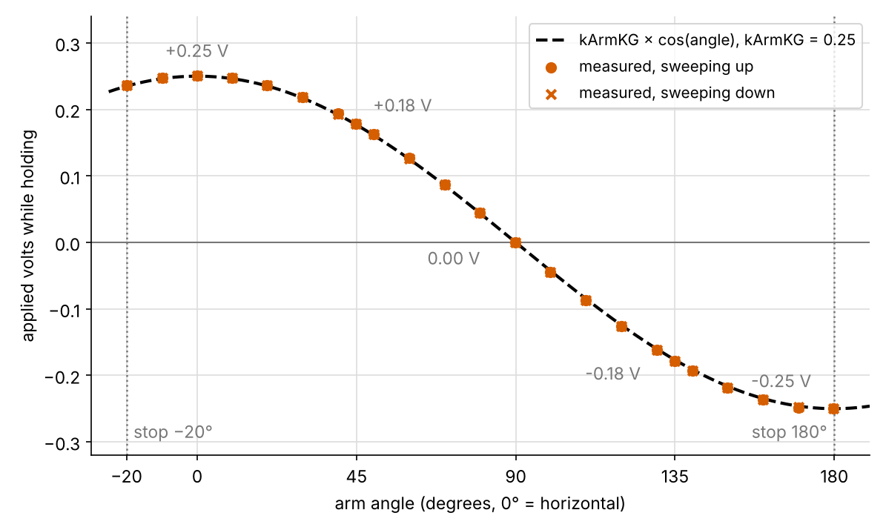

# Control math: gears, models and P control

Control is the part of the code that turns "where I want the mechanism to be" into "how hard
to push it, right now". It runs on a little arithmetic: unit walks through a gearbox, an error,
and a model of the motor.

The examples come from the course's final code, after
[Lesson 33](../../lessons/v3/33-tuning-with-sysid.md), unless they say otherwise, and each
one links to the lesson section where you write it. How the motor's own loop is configured is
on the [TalonFX](../frc-hardware/01-talonfx.md) page; this page is about the numbers that go
into it.

## 1. Walking units through a gearbox

Every mechanism question starts as a unit walk: from what the motor's sensor counts (rotor
turns) to what the mechanism does (drum turns), to what you care about (metres). Gear ratios
are the steps. The elevator's gearbox is 12 : 1, twelve rotor turns per drum turn, and one drum
turn lifts the carriage one drum circumference:

<!-- source: lesson-33 subsystems/ElevatorIOTalonFX.java -->
*Example, from `ElevatorIOTalonFX.java` ([Lesson 18, section 6](../../lessons/v3/18-elevator.md#6-the-hardware-implementation-elevatoriotalonfx)):*
```java
/** Drum rotations for a given carriage height — the drum's circumference does the conversion. */
protected static double metersToRotations(double meters) {
  return meters / (2 * Math.PI * ElevatorConstants.kDrumRadius.in(Meters));
}
```

The motor already reports in drum rotations, because the configuration's
`SensorToMechanismRatio` takes the 12 : 1 out. <!-- claim: phoenix6.sensor-to-mechanism-ratio -->
So this method only has the last step to do, drum turns to metres. Write each walk out once in
words, "rotor turns, divided by 12, times 0.160 m", and the code is a copy of the sentence.

**Which way to divide is the trap.** Speeds and turns are divided by the gear ratio on the way
to the mechanism (the drum turns slower than the rotor); torque is multiplied (the drum pushes
harder). Get one backwards and the answer is wrong by the ratio squared.

<details class="quiz" id="q-control-1" markdown="1">
<summary>Check yourself: the elevator's rotor turns 24 times. How far has the carriage moved, with a 12 : 1 gearbox and a drum 0.160 m round?</summary>

- [ ] 24 × 0.160 = 3.84 m *That treats rotor turns as drum turns.*
- [x] 24 ÷ 12 = 2 drum turns, × 0.160 = 0.32 m *Rotor turns divide by the ratio to give drum turns.*
- [ ] 24 × 12 × 0.160 = 46 m *The drum turns slower than the rotor, not faster.*

</details>

<details class="quiz" id="q-control-2" markdown="1">
<summary>Check yourself: with `SensorToMechanismRatio` set to 12, what does `metersToRotations` have to convert?</summary>

- [ ] Rotor rotations to drum rotations, and then to metres. *The configuration already did the first step.*
- [x] Only between drum rotations and metres, using the drum's circumference. *The motor reports in drum rotations.*
- [ ] Nothing: the motor reports metres. *It reports mechanism rotations, not metres.*

</details>

## 2. Setpoint, measurement, error, and P control

Every controller in the course starts from three words. The **setpoint** is where you want to
be, the **measurement** is where you are, and the **error** is the gap, setpoint minus
measurement. **Proportional control** (P control) pushes in proportion to the error: a big gap
gets a big push, and the push fades as the gap closes. The heading turn is the course's plainest
example:

<!-- source: lesson-33 subsystems/Drivetrain.java -->
*Example, from `Drivetrain.java` ([Lesson 8, section 3](../../lessons/v3/08-gyro-heading.md#3-turn-to-a-heading--the-same-p-control-again)):*
```java
while (Math.abs(headingError(targetDegrees)) >= 2.0) {
  double omega = clamp(
      m_headingKP.get() * headingError(targetDegrees),
      -0.5, 0.5); // clamp to ±50% turn power
  commandRotation(omega);
  coroutine.yield();
}
```

The gain **`kP`** is how hard to push per unit of error; here it's `m_headingKP`, a tunable that
starts at `HeadingConstants.kP` and can be changed while the robot runs. The clamp keeps a large error from asking
for more than the robot should give. Figure 5.1 shows one move under P control: read the top panel
for the angle chasing its setpoint, then the bottom for the output, which follows the gap.


*Figure 5.1, from [Lesson 5](../../lessons/v3/05-steering-p-control.md#figure-5-1) — One move to 90° with `kP = 0.0005`: the measurement against the setpoint, and the output that follows the gap.* <!-- claim: l05.kp-0005-overshoot -->

<details class="quiz" id="q-control-3" markdown="1">
<summary>Check yourself: with `kP = 0.0005`, the wheel is at 20° and the setpoint is 90°. What does P control ask for?</summary>

- [x] 0.0005 × 70 = 0.035 *The error is 90 − 20 = 70, and P multiplies it by the gain.*
- [ ] 0.0005 × 90 = 0.045 *That uses the setpoint, not the error.*
- [ ] 0.0005 × 20 *That uses the measurement.*

</details>

<details class="quiz" id="q-control-4" markdown="1">
<summary>Check yourself: what happens to P control's output as the measurement reaches the setpoint?</summary>

- [ ] It stays at its last value. *It's recomputed from the error every tick.*
- [x] It fades toward zero, because the error does. *The push is proportional to the gap.*
- [ ] It reverses straight away. *It only reverses if the mechanism overshoots.*

</details>

## 3. Too much gain, too little

A gain that's too big makes the mechanism overshoot and ring: it arrives too fast, sails past,
and swings back and forth. A gain too small crawls, and can stop short. Figure 5.2 shows the same
90° tap with three gains.


*Figure 5.2, from [Lesson 5](../../lessons/v3/05-steering-p-control.md#figure-5-2) — The same tap with three gains: too big, about right, too small.* <!-- claim: l05.kp-0005-overshoot, l05.kp-0005-settle, l05.kp-3e-5-settle, l05.kp-1e-5-stall -->

The biggest gain overshoots to 158° and rings for about seven seconds. The middle one is within a
degree at 2.7 s with no overshoot. The smallest stalls at 79°, because its push near the end is
so small the simulated motor rounds it to nothing. <!-- claim: l05.kp-0005-overshoot, l05.kp-0005-settle, l05.kp-3e-5-settle, l05.kp-1e-5-stall, phoenix6.sim-small-voltage-rounds-to-zero -->

Tuning by hand works from either side: double the gain while it crawls, halve it while it rings.
And a gain belongs to its mechanism. The same `kP` on the real 25 : 1 steering gearbox, from
Lesson 7, is far too gentle: it takes about six seconds to get within a degree. <!-- claim: l07.kp-0005-within-1deg -->

<details class="quiz" id="q-control-5" markdown="1">
<summary>Check yourself: your mechanism overshoots its setpoint and swings back and forth before settling. What do you change?</summary>

- [ ] Double `kP`. *That makes it arrive faster and overshoot more.*
- [x] Halve `kP`. *Ringing means the gain is too big.*
- [ ] Remove the clamp. *The clamp limits the push; it isn't what causes ringing.*

</details>

<details class="quiz" id="q-control-6" markdown="1">
<summary>Check yourself: why did the smallest gain in Figure 5.2 stop at 79° and never reach 90°?</summary>

- [ ] It ran out of time. *It sat at 79° for good.*
- [x] Near the end its push was so small that the simulated motor applied nothing at all. *A tiny command rounds to zero volts.*
- [ ] P control can never reach the setpoint. *The middle gain reached it.*

</details>

## 4. Feedforward: predict with a model

P control only reacts: it needs an error before it does anything. **Feedforward** predicts: it
works out from a model of the motor how much voltage the goal costs, and asks for that straight
away. P then only trims what the model got wrong. The terms the course uses:

- **`kV`**: volts to keep moving at one unit of speed.
- **`kA`**: volts to speed up by one unit per second.
- **`kG`**: volts to hold the mechanism up against gravity.
- **`kS`**: volts to get it moving at all, against friction.

Most of them can be computed from two facts about the Kraken X60 motor, the figures WPILib's motor
model uses: 6065 RPM free speed and 7.157 N·m stall torque at 12 V. <!-- claim: wpilib.kraken-x60-model -->
That's **0.1187 V per rotor rotation per second** (12 ÷ 101.08) and **1.677 V per N·m** at the
rotor (12 ÷ 7.157). Then walk through the gearbox:

<!-- source: lesson-33 Constants.java -->
*Example, from `Constants.java`'s `ElevatorConstants` ([Lesson 18, section 3](../../lessons/v3/18-elevator.md#3-the-feedforward-model-computed-from-the-motors-numbers)):*
```java
// SensorToMechanismRatio makes the closed loop run in drum rotations, so
// every gain below is drum-side (mechanism-side), not rotor-side.
public static final double kElevatorKG = 0.17; // volts to hold position against gravity
public static final double kElevatorKV = 1.42; // volts per drum rotation/sec
public static final double kElevatorKA = 0.003; // volts per drum rotation/sec^2
public static final double kElevatorKP = 20.0; // volts per drum rotation of error — the trim
```

- **`kV`:** one drum rotation per second is 12 rotor rotations per second, and 12 × 0.1187 is
  about 1.42 V.
- **`kG`:** 5 kg pulls with 49 N, which at the drum's 0.0254 m radius is 1.246 N·m. Through the
  gearbox that's 1.246 ÷ 12 = 0.104 N·m at the rotor, and 0.104 × 1.677 is about 0.17 V. <!-- claim: wpilib.kraken-x60-model -->

Figure 18.1 shows what the model buys. Read the top panel first: with `kP` alone the carriage
trails its planned path by up to about 8 cm while moving; with the model it sits on the plan. <!-- claim: l18.kp-alone-lag -->
Then the bottom panel, the hold: `kP` alone settles about 1.5 mm low, the model about a fifth of
a millimetre. <!-- claim: l18.kp-alone-hold, l18.model-hold-gap -->


*Figure 18.1, from [Lesson 18](../../lessons/v3/18-elevator.md#figure-18-1) — What `kP` alone does, moving and holding, next to the full model. The lower panel zooms in on the hold.* <!-- claim: l18.kp-alone-lag, l18.kp-alone-hold, l18.model-hold-gap -->

`kP` alone always sags a little, because it can only push back once there's an error to push
against.

<details class="quiz" id="q-control-7" markdown="1">
<summary>Check yourself: the arm's gearbox is 50 : 1. Using 0.1187 V per rotor rotation per second, what's its `kV` in volts per arm rotation per second?</summary>

- [ ] 0.1187 ÷ 50 *An arm rotation is 50 rotor rotations, so it costs more, not less.*
- [x] 50 × 0.1187, about 5.94 *One arm turn per second is 50 rotor turns per second.*
- [ ] 0.1187, the same as the rotor. *The gearbox changes it.*

</details>

<details class="quiz" id="q-control-8" markdown="1">
<summary>Check yourself: why does `kP` alone leave the carriage holding a little below its goal?</summary>

- [ ] `kP` is set too high. *A higher `kP` would shrink the sag, not cause it.*
- [x] P only pushes when there's an error, so it needs a small sag to make the push that holds the weight up. *`kG` pays for gravity without waiting for an error.*
- [ ] The motor can't hold anything still. *With `kG` it holds a fifth of a millimetre from the goal.*

</details>

## 5. Gravity that depends on the angle

An elevator's carriage weighs the same at every height, so its `kG` is one number. An arm is
different: holding it straight out takes the most effort, and holding it straight up takes none.
So the motor scales the arm's `kG` by the cosine of its angle, measured from horizontal. <!-- claim: phoenix6.arm-cosine-gravity -->
Figure 20.2 checks that against the simulated arm.



*Figure 20.2, from [Lesson 20](../../lessons/v3/20-intake-arm.md#figure-20-2) — Applied volts while holding, at 23 angles from −20° to 180°, against the curve `kArmKG × cos θ`. The arm was swept up and then back down.* <!-- claim: l20.hold-fit-error -->

Every measured point sits on the dashed curve: +0.25 V straight out, nothing straight up, and
−0.25 V straight out the other side. <!-- claim: l20.hold-horizontal, l20.hold-vertical -->
The cosine only works if the sensor reads zero with the arm horizontal, which is why that's the
arm's angle convention.

<details class="quiz" id="q-control-9" markdown="1">
<summary>Check yourself: with `kArmKG = 0.25`, what does it take to hold the arm at 60°?</summary>

- [ ] 0.25 V, the same at every angle. *That's an elevator's flat `kG`.*
- [x] 0.25 × cos 60° = 0.125 V *Gravity's lever arm shrinks as the arm rises.*
- [ ] 0 V *That's straight up, at 90°.*

</details>

<details class="quiz" id="q-control-10" markdown="1">
<summary>Check yourself: why does the arm's cosine gravity need the sensor to read zero with the arm horizontal?</summary>

- [x] The cosine is largest at zero, so zero has to be where holding takes the most effort: straight out. *With zero anywhere else, `kG` pushes hardest at the wrong angle.*
- [ ] Phoenix can't read negative angles. *The arm's range goes down to −20°.*
- [ ] So the soft limits work. *Soft limits use whatever zero the sensor has.*

</details>

## 6. Motion profiles: a plan for getting there

Asking a mechanism to jump straight to its goal asks for a huge push at the start. A **motion
profile** plans the trip instead: speed up at a set acceleration, cruise at a set speed, slow
down in time to stop. The controller then follows the plan's **setpoint**, which moves, while the
**goal** stays put. <!-- claim: phoenix6.closed-loop-reference-is-profile-setpoint -->

The elevator's plan runs in the motor, as **Motion Magic**. Figure 18.2 shows the three things to
tell apart: the goal steps to 1.5 m, the setpoint ramps up to it over about two seconds, and the
height follows the setpoint. <!-- claim: l18.profile-duration -->

![Above: goal, setpoint and height during one move from stowed to the top of the travel. The goal is a step to 1.5 m and the setpoint ramps up to it over about two seconds. The height with the model follows so closely that it overlaps the setpoint; with kElevatorKV zeroed it runs parallel but about 9 cm behind through the middle of the move. Below: setpoint minus height in millimeters, which opens, holds at about 91 mm through the cruise and closes with kElevatorKV zeroed, and stays near a centimeter with the model](../../lessons/v3/images/18-height-setpoint-goal.png)

*Figure 18.2, from [Lesson 18](../../lessons/v3/18-elevator.md#figure-18-2) — One move from stowed to the top. Above: goal, setpoint and height, with the model and with `kElevatorKV` zeroed. Below: setpoint minus height for both.* <!-- claim: l18.kv-zeroed-lag, l18.model-lag, l18.profile-duration -->

Take `kV` away and the height runs about 9 cm behind the setpoint through the cruise; with the
model it stays within a centimetre or two. <!-- claim: l18.kv-zeroed-lag, l18.model-lag -->

The drive-to-pose command plans in software instead, with WPILib's `TrapezoidProfile` inside a
`ProfiledPIDController`. A trapezoid uses one acceleration for speeding up *and* slowing down, so
"firm out of the blocks, gentle into the target" takes two profiles, which is why Lesson 26 drives
in two stages. <!-- claim: wpilib.trapezoid-profile-single-acceleration -->

<details class="quiz" id="q-control-11" markdown="1">
<summary>Check yourself: in Figure 18.2, at half a second into the move, which of goal, setpoint and height is already 1.5 m?</summary>

- [x] Only the goal. *The goal steps at once; the setpoint ramps toward it and the height follows the setpoint.*
- [ ] The setpoint. *It takes about two seconds to get there.*
- [ ] All three. *The plan exists so the carriage doesn't try to get there at once.*

</details>

<details class="quiz" id="q-control-12" markdown="1">
<summary>Check yourself: why does Lesson 26's drive to a pose use two profiled stages?</summary>

- [ ] One profile can't hold more than a metre. *Distance isn't the limit.*
- [x] A `TrapezoidProfile` uses one acceleration for both speeding up and slowing down, and the drive wants a firm launch and a gentle arrival. *Two profiles, two accelerations.*
- [ ] The robot has two drive motors per module. *It has one drive motor per module.*

</details>

## 7. Loops in software, and checking a gain

Some loops run in your code, not the motor. WPILib's **`PIDController`** does P control for you:
`calculate(measurement, setpoint)` returns the gain times the error. <!-- claim: wpilib.pid-controller-api -->
The path follower takes three of them, one for each job, and adds up what they ask for:

<!-- source: lesson-33 commands/Autos.java -->
*Example, from `Autos.java`'s `makePathBuilder` ([Lesson 17, section 6](../../lessons/v3/17-bline-autos.md#6-meet-followpathbuilder)):*
```java
PIDController translation = new PIDController(PathConstants.kTranslationP, 0, 0);
PIDController rotation = new PIDController(PathConstants.kRotationP, 0, 0);
PIDController crossTrack = new PIDController(PathConstants.kCrossTrackP, 0, 0);
```

They have to be three separate objects: passing the same one twice throws. <!-- claim: bline.builder-distinct-pids -->
Each one's P is also a tunable, read and set through `getP` and `setP`, so it can be tuned while a
path runs. <!-- claim: wpilib.tunables-getter-setter -->
Figure 17.1 draws the three loops on one tick.


*Figure 17.1, from [Lesson 17](../../lessons/v3/17-bline-autos.md#figure-17-1) — The three loops on one tick. Each looks at its own error, and the follower adds up what they ask for.*

Computed gains are a starting point. On a real robot you **measure** them, by running the mechanism
through known voltages and fitting the model to what it did: that's SysId, in Lesson 33. A measured
number still needs checking. One quick check for `kV`: 12 V ÷ `kV` should be close to the
mechanism's free speed, and a fit of the simulated flywheel gives 0.118, which passes. <!-- claim: l33.hand-fit-kv -->
And `kS` in the simulator is near zero, because the simulated wheel has no friction: even 0.05 V
turns it. <!-- claim: l33.hand-fit-ks, phoenix6.sim-no-static-friction -->

<details class="quiz" id="q-control-13" markdown="1">
<summary>Check yourself: `PIDController(5.0, 0, 0)` gets a measurement of 1.0 and a setpoint of 1.4. What does `calculate` return?</summary>

- [ ] 5.0 × 1.4 = 7.0 *P uses the error, not the setpoint.*
- [x] 5.0 × 0.4 = 2.0 *The gain times setpoint minus measurement.*
- [ ] 0.4 *That's the error before the gain.*

</details>

<details class="quiz" id="q-control-14" markdown="1">
<summary>Check yourself: a fit gives a flywheel `kV` of 0.06 V per rot/s, and the wheel's free speed is about 101 rot/s at 12 V. Does that pass the quick check?</summary>

- [ ] Yes: any positive `kV` is plausible. *The check compares it with something you know.*
- [x] No: 12 ÷ 0.06 = 200 rot/s, about twice the free speed, so the number is suspect. *A `kV` should put 12 V near the free speed.*
- [ ] It can't be checked without running SysId again. *The free speed is the check.*

</details>

## Common mistakes

- **Dividing where you should multiply** walking through a gearbox. Speeds and turns divide by
  the ratio toward the mechanism; torque multiplies ([section 1](#1-walking-units-through-a-gearbox)).
- **Using the setpoint, or the measurement, where the error belongs.**
- **Raising `kP` to fix sag.** A model term (`kG`, `kV`) fixes it without the side effects.
- **Treating a gain as portable.** It belongs to one mechanism, in that mechanism's units.
- **An arm's angle with zero somewhere other than horizontal.** Cosine gravity then pushes
  hardest at the wrong angle.
- **Confusing the goal with the setpoint** when reading a profiled move's graph.
- **Trusting a measured gain unchecked.** Compare it with the motor's numbers first.

## Where this comes from

- **[Lesson 5](../../lessons/v3/05-steering-p-control.md):** setpoint, error and P control, and
  tuning `kP`.
- **[Lesson 6](../../lessons/v3/06-distance-and-commands.md):** rotations to metres.
- **[Lesson 12](../../lessons/v3/12-model-based-control.md):** feedforward and the motor's own
  loop.
- **[Lesson 17](../../lessons/v3/17-bline-autos.md):** `PIDController`, three loops at once.
- **[Lesson 18](../../lessons/v3/18-elevator.md):** `kG`, `kV` and `kA` from the motor's numbers,
  and Motion Magic.
- **[Lesson 20](../../lessons/v3/20-intake-arm.md):** cosine gravity.
- **[Lesson 26](../../lessons/v3/26-drive-to-pose.md):** profiles in software.
- **[Lesson 28](../../lessons/v3/28-flywheel.md):** a velocity goal, and what `kV` is worth.
- **[Lesson 33](../../lessons/v3/33-tuning-with-sysid.md):** measuring the gains, and checking
  them.

## Quick reference

| Term | What it is |
|---|---|
| setpoint, measurement, error | where you want to be, where you are, the gap between them |
| `kP` | push per unit of error |
| `kV` | volts per unit of speed |
| `kA` | volts per unit of acceleration |
| `kG` | volts to hold against gravity (flat for an elevator, × cos θ for an arm) |
| `kS` | volts to overcome friction |
| 0.1187 V per rotor rot/s | the Kraken X60's speed factor (12 ÷ 101.08) |
| 1.677 V per N·m | the Kraken X60's torque factor (12 ÷ 7.157) |
| goal and setpoint | where the move ends, and where the plan says to be now |
| `PIDController(kP, 0, 0).calculate(measured, setpoint)` | P control in your code |
| `TrapezoidProfile`, `ProfiledPIDController` | a plan with one acceleration, in your code |
