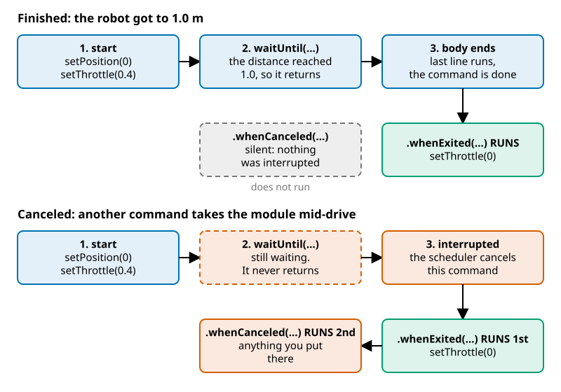
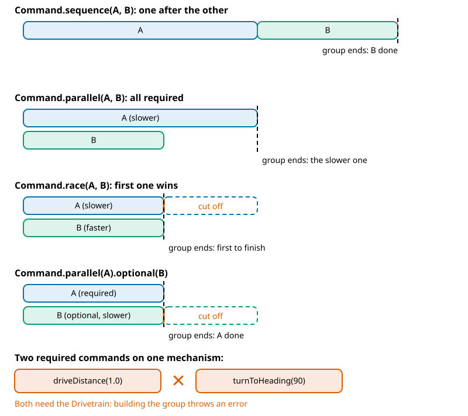

# Commands and triggers

A command is one job for the robot, such as "go to this height" or "drive with the sticks",
and a trigger is a condition that starts or stops one.

The examples come from the course's final code, after
[Lesson 33](../../lessons/v3/33-tuning-with-sysid.md), unless they say otherwise, and each
one links to the lesson section where you write it. How a command's *body* is written
(lambdas, `yield`, `await`) is on the
[Lambdas and coroutines](../java/04-lambdas-coroutines.md) page; this page is about what
the scheduler does with the command once it exists.

## 1. Mechanisms, and one job at a time

A **mechanism** is a part of the robot that can only do one thing at a time: the
elevator, the arm, the drivetrain. In code it's a class that says `implements Mechanism`:

<!-- source: lesson-33 subsystems/Elevator.java -->
*Example, from `Elevator.java` ([Lesson 18, section 8](../../lessons/v3/18-elevator.md#8-the-elevator-mechanism)):*
```java
public class Elevator implements Mechanism {
  // ...
}
```

That one line is enough for the scheduler to know about it, from the moment it's
built. <!-- claim: commandsv3.mechanism-registers-with-scheduler -->

A command made by one of the mechanism's own factories, like `run(...)` or
`runRepeatedly(...)`, **requires** that mechanism. The scheduler's rule is simple: one
command per mechanism. If you start a second command that needs the same mechanism, the
one already running is cancelled. <!-- claim: commandsv3.conflicting-command-interrupts -->
That's why pressing the arm button while the roller spins stops the roller: both are the
arm's.

Here's the wrong picture to drop: the robot doesn't run every command you've started, side
by side, each pulling the motors its own way. A mechanism has exactly one owner at any
moment, and the newest request wins.

<details class="quiz" id="q-commands-1" markdown="1">
<summary>Check yourself: the elevator is running `goToHeight(...)` when the driver presses Back, which starts `home()`. Both require the elevator. What happens?</summary>

- [ ] Both run, and the motor gets the average of what they ask for. *A mechanism has one owner at a time; nothing averages.*
- [ ] `home()` waits until `goToHeight` is done. *The scheduler doesn't queue it. The newer command takes over.*
- [x] `goToHeight` is cancelled and `home()` takes over. *Scheduling a command on a mechanism cancels whatever was running on it.*

</details>

<details class="quiz" id="q-commands-2" markdown="1">
<summary>Check yourself: what do you have to do so the scheduler knows the `Elevator` exists?</summary>

- [x] Nothing beyond `implements Mechanism`; it's known from the moment it's built. *There's no separate registration call.*
- [ ] Call a register method in `Robot`'s constructor. *Commands V3 has no such step for a mechanism.*
- [ ] Give it a default command. *A default command is optional; the elevator is a mechanism with or without one.*

</details>

## 2. Making a command

Commands come from **factory methods**: a method on the mechanism that builds and returns
a new `Command`. Each one ends with `.named(...)`:

<!-- source: lesson-33 subsystems/Elevator.java -->
*Example, from `Elevator.java` ([Lesson 18, section 8](../../lessons/v3/18-elevator.md#8-the-elevator-mechanism)):*
```java
public Command goToHeight(Distance target) {
  return runRepeatedly(() -> {
        m_goal = clampToTravel(target);
        m_io.setGoalHeightMeters(m_goal.in(Meters));
      })
      .until(this::atGoal)
      .named("Go To Height");
}
```

The name isn't decoration. `runRepeatedly(...)`, `run(...)`, `Command.noRequirements(...)`,
`Command.sequence(...)` and `Command.parallel(...)` all return a *builder*, not a command.
You can add things to it, like `.until(...)` or `.whenExited(...)`, and `.named(...)` is the
step that turns it into a `Command`. <!-- claim: commandsv3.builders-need-a-name --> The
name is also what shows up in the logs as `Elevator/CurrentCommand`, so pick one you'd
recognise in a graph.

`.until(condition)` ends the command once the condition is true, checked every tick. This
one would run forever on its own, so `until(this::atGoal)` is what makes it finish on
arrival.

A command that should belong to no mechanism at all, like a plan that only starts other
commands, or a quick request that flips a flag, is built with
`Command.noRequirements(...)`. No rival can take it over, because it claims
nothing. <!-- claim: commandsv3.no-requirements-exists -->

<details class="quiz" id="q-commands-3" markdown="1">
<summary>Check yourself: a factory returns `runRepeatedly(() -> ...)` with no `.named(...)` at the end. Why won't that compile as a `Command`?</summary>

- [ ] Every command needs a `whenExited` hook. *Hooks are optional.*
- [x] `runRepeatedly` returns a builder, and `.named(...)` is what turns the builder into a `Command`. *Until it's named, it isn't a `Command` yet.*
- [ ] `runRepeatedly` needs a mechanism passed in. *It's called on the mechanism already, so it knows which one it requires.*

</details>

<details class="quiz" id="q-commands-4" markdown="1">
<summary>Check yourself: what makes `goToHeight` finish?</summary>

- [ ] `runRepeatedly` runs its lambda once and stops. *`runRepeatedly` runs it every tick, forever, on its own.*
- [x] `.until(this::atGoal)`: once the elevator is at its goal, the command ends. *`until` checks its condition every tick.*
- [ ] Nothing; it runs until another command takes the elevator. *Without the `until` that would be true, but this one ends on arrival.*

</details>

## 3. How a command ends, and cleaning up

A command can end two ways:

- **It finishes**: its body runs out of code, or its `until(...)` condition comes true.
- **It's cancelled**: a button is let go, another command takes its mechanism, or the robot
  is disabled.

Motors keep doing the last thing they were told, so a command that moves something has to
put it right when it ends. Two hooks do that:

- **`.whenExited(...)`** runs however the command ends, finished or cancelled.
- **`.whenCanceled(...)`** runs only when it didn't finish by itself. On a cancel, both run,
  `whenExited` first. <!-- claim: commandsv3.when-exited-on-cancel -->

Figure 6.1 draws the two endings side by side. Read the top half first: the body finishes
and only `whenExited` runs. In the bottom half something interrupts it and both run.



*Figure 6.1, from [Lesson 6](../../lessons/v3/06-distance-and-commands.md#figure-6-1) — The two endings of `driveDistance`, and which hooks run.* <!-- claim: commandsv3.when-exited-on-cancel -->

When the cleanup should happen no matter what, which is most of the time, use
`whenExited`:

<!-- source: lesson-33 subsystems/Drivetrain.java -->
*Example, from `Drivetrain.java` ([Lesson 8, section 3](../../lessons/v3/08-gyro-heading.md#3-turn-to-a-heading--the-same-p-control-again)):*
```java
public Command turnToHeading(double targetDegrees) {
  return run(coroutine -> {
        // ...
      })
      .whenExited(() -> commandRotation(0.0)) // however it ends — stop
      .named("Turn To Heading");
}
```

**The surprise: `.until(...)` ends a command by cancelling it.** So a `whenCanceled` hook
on a command with `until` runs when the condition comes true, too. <!-- claim: commandsv3.when-exited-on-cancel -->
The elevator's homing command relies on exactly that. It pushes down until the switch
trips, and its "cancelled" hook is where it believes the switch:

<!-- source: lesson-33 subsystems/Elevator.java -->
*Example, from `Elevator.java` ([Lesson 21, section 5](../../lessons/v3/21-limit-sensors.md#5-the-homing-routine)):*
```java
public Command home() {
  return runRepeatedly(() -> m_io.setVoltage(ElevatorConstants.kHomingVolts.in(Volts)))
      .whenCanceled(() -> {
        m_io.setVoltage(0);
        acceptBottomLimit();
        m_goal = ElevatorConstants.kBottomLimitHeight;
        m_homed = true;
      })
      .until(this::atBottomLimit)
      .named("Home");
}
```

<details class="quiz" id="q-commands-5" markdown="1">
<summary>Check yourself: `driveDistance` reaches its distance and its body runs out of code. Which hooks run?</summary>

- [x] `whenExited` only. *It finished by itself, so the cancel hook stays silent.*
- [ ] `whenCanceled` only. *Nothing cancelled it. A command that stopped its motors only in `whenCanceled` would keep driving here.*
- [ ] Both, `whenExited` first. *That's what a cancel does.*

</details>

<details class="quiz" id="q-commands-6" markdown="1">
<summary>Check yourself: the switch trips and `home()`'s `.until(this::atBottomLimit)` comes true. Does its `whenCanceled` hook run?</summary>

- [ ] No: the command finished, and `whenCanceled` only runs on a cancel. *That would be true of a body that ran out of code, but `until` doesn't end things that way.*
- [x] Yes: `until` ends the command by cancelling it, so the hook runs and the encoder is re-zeroed. *That's what `home()` is counting on.*
- [ ] Only if the driver lets go of Back. *Back is bound with `onTrue`, so letting go doesn't touch the command.*

</details>

## 4. Default commands

A mechanism can have a **default command**: what it does whenever nothing else wants it.
It starts by itself when the mechanism is free and comes back by itself when the command
that took over ends. <!-- claim: commandsv3.default-command-runs-when-idle --> The drive
sticks work this way: tap a button that turns the robot, and when the turn ends the sticks
are back in charge, with no code to hand them back. <!-- claim: commandsv3.default-command-resumes -->

Nothing installs a default command for you. <!-- claim: commandsv3.mechanism-no-default-command -->
The flywheel sets one in its constructor, so it idles in every opmode:

<!-- source: lesson-33 subsystems/Flywheel.java -->
*Example, from `Flywheel.java` ([Lesson 28, section 5](../../lessons/v3/28-flywheel.md#5-a-picture-of-a-number)):*
```java
public Flywheel() {
  Scheduler.getDefault().addPeriodic(this::periodic);
  // ...
  setDefaultCommand(idle());
}

@Override
public Command idle() {
  return spinUp(FlywheelConstants.kIdleSpeed);
}
```

`idle()` is a built-in, do-nothing command that every mechanism has; the flywheel
overrides it to spin at its idle speed instead. <!-- claim: commandsv3.mechanism-idle-overridable -->

<details class="quiz" id="q-commands-7" markdown="1">
<summary>Check yourself: the driver taps a button that runs `turnToHeading(90)`. The turn finishes. What drives the robot now?</summary>

- [ ] Nothing, until another button is pressed. *The drivetrain's default command comes back by itself.*
- [x] The default command: the sticks, through `driveFieldRelative`. *A default command resumes whenever the mechanism is free again.*
- [ ] `turnToHeading` keeps holding 90°. *It finished; a finished command doesn't run any more.*

</details>

<details class="quiz" id="q-commands-8" markdown="1">
<summary>Check yourself: a new mechanism class never calls `setDefaultCommand`. What does it do when no command is running?</summary>

- [x] Nothing: no command runs on it. *Nothing installs a default command for you.*
- [ ] It runs `idle()` automatically. *`idle()` exists on every mechanism, but it only runs if you make it the default.*
- [ ] It repeats the last command it ran. *A finished or cancelled command stays ended.*

</details>

## 5. Putting commands together

Several commands can make one bigger one:

- **`Command.sequence(a, b, c)`** runs them one after another.
- **`Command.parallel(a, b)`** runs them at the same time and finishes when all of them
  have. <!-- claim: commandsv3.parallel-race-optional -->
- **`Command.race(a, b)`** runs them at the same time and finishes when any one does,
  cancelling the rest. <!-- claim: commandsv3.parallel-race-optional -->

Figure 9.2 draws when each kind ends, using the same two commands, A and B, in every row.
The dashed line is the moment the group is done, and a dashed "cut off" box is a command
that was still running then and got cancelled.



*Figure 9.2, from [Lesson 9](../../lessons/v3/09-autonomous.md#figure-9-2) — When each group ends: `sequence` ends with its last command, `parallel` with the slowest, `race` with the fastest, and `.optional(...)` with the required command.* <!-- claim: commandsv3.parallel-race-optional -->

Two rules come with them. **Commands running in parallel can't share a mechanism**: the
group refuses to be built, with an `IllegalArgumentException`, the moment you try. <!-- claim: commandsv3.parallel-shared-requirements-throws -->
So the arm and the elevator can move together, but two arm commands have to take turns:

<!-- source: lesson-33 subsystems/Superstructure.java -->
*Example, from `Superstructure.java` ([Lesson 24, section 6](../../lessons/v3/24-superstructure.md#6-motion-unguarded-because-arriving-already-said-yes)):*
```java
/** Both steps require Arm — the same Mechanism — so this has to be a sequence, not a parallel. */
public Command intakeMotion() {
  return Command.sequence(
          m_arm.goToAngle(ArmConstants.kIntake),
          m_arm.runRoller(ArmConstants.kIntakeSpeed))
      .named("Intake Motion");
}

public Command handoffMotion() {
  return Command.parallel(
          m_arm.goToAngle(ArmConstants.kStowed),
          m_elevator.goToHeight(ElevatorConstants.kScoreMid))
      .named("Handoff Motion");
}
```

And **a group holds every mechanism any of its commands needs, for as long as the group
runs.** A sequence that starts by homing the elevator keeps the elevator until its last
step ends, so anything else that wants the elevator in the meantime cancels the whole
group. <!-- claim: commandsv3.sequence-requires-union --> Figure 25.1 shows it happening:
the top half is a sequence that loses the whole auto that way, and the bottom half is the
fix, a coroutine that awaits each step and holds only what the current step needs. The
[Lambdas and coroutines](../java/04-lambdas-coroutines.md#5-waiting-for-something) page
shows that version's code.


*Figure 25.1, from [Lesson 25](../../lessons/v3/25-path-events.md#figure-25-1) — Who holds the elevator, and what happens when the state turns `IDLE`. Block widths are not to scale.* <!-- claim: commandsv3.sequence-requires-union -->

<details class="quiz" id="q-commands-9" markdown="1">
<summary>Check yourself: why is `intakeMotion` a sequence and not a parallel group?</summary>

- [ ] A parallel group would be too fast for the arm. *Speed has nothing to do with it.*
- [x] Both steps require the arm, and commands in parallel can't share a mechanism. *Building that parallel group throws an exception straight away.*
- [ ] Parallel groups can only hold two commands. *They can hold as many as you like, as long as no two share a mechanism.*

</details>

<details class="quiz" id="q-commands-10" markdown="1">
<summary>Check yourself: `Command.race(a, b)`, where `a` takes 1 second and `b` takes 3. When does the race end, and what happens to `b`?</summary>

- [ ] After 3 seconds, when both are done. *That's `Command.parallel`.*
- [x] After 1 second, and `b` is cancelled. *A race ends with its fastest command and cancels the rest.*
- [ ] After 1 second, and `b` carries on by itself. *Nothing in a race outlives it; the rest are cancelled.*

</details>

## 6. Triggers: when a command starts and stops

A **trigger** is a condition the scheduler checks every tick, with commands bound to it.
A controller button is one, but so is any `true`/`false` you can write as a lambda. The two
bindings the course leans on:

- **`onTrue(command)`** starts the command once, on the tick the trigger becomes true. Letting
  go doesn't stop it: the command runs until it finishes or something else cancels
  it. <!-- claim: commandsv3.ontrue-starts-not-stops -->
- **`whileTrue(command)`** starts it when the trigger becomes true and cancels it when the
  trigger becomes false. <!-- claim: commandsv3.whiletrue-schedules-and-cancels -->

Which one to use is a question about letting go. Homing is a tap: once it's started it
should carry on, so Back uses `onTrue`. Spinning up to shoot is a hold: let go and the
flywheel should drop back to idle, so the left trigger uses `whileTrue`.

<!-- source: lesson-33 opmode/RobotTeleop.java -->
*Example, from `RobotTeleop.java` ([Lesson 21, section 7](../../lessons/v3/21-limit-sensors.md#7-wire-it-up)):*
```java
// Back homes the elevator: the encoder can't know where the carriage is
// at power-on, so drive down to the switch and let it say.
robot.driverController.back().onTrue(robot.elevator.home());

// A Trigger is any boolean the scheduler polls — it does not have to be
// a button. Whenever the switch trips, take its word for the height.
new Trigger(robot.elevator::atBottomLimit).onTrue(robot.elevator.rezeroAtBottom());
```

<!-- source: lesson-33 opmode/RobotTeleop.java -->
*Example, also from `RobotTeleop.java` ([Lesson 28, section 4](../../lessons/v3/28-flywheel.md#4-the-subsystem)):*
```java
// Same trigger, different subsystem: lining up and spinning up are the
// same decision, so they happen together.
robot.driverController.leftTrigger().whileTrue(
    robot.flywheel.spinUp(FlywheelConstants.kShootSpeed));
```

When the left trigger is let go, `whileTrue` cancels `spinUp`, the flywheel is free, and
its default command, the idle spin, comes back by itself. <!-- claim: commandsv3.default-command-resumes -->
The second binding in the first example is a trigger built from a method reference, so it
fires when a limit switch closes, with no button involved. <!-- claim: commandsv3.trigger-from-supplier-runs-disabled -->

Triggers combine. `.and(...)` makes a trigger that's true only while both parts are, and
`.debounce(time)` makes one that only turns true once its condition has held for that
long. <!-- claim: commandsv3.trigger-combinators, commandsv3.debounce-rising --> Lesson 22 debounces the beam break, so a
game piece tumbling past the sensor can't set off a capture:

<!-- source: lesson-22 opmode/RobotTeleop.java -->
*Example, from Lesson 22's `RobotTeleop.java` ([Lesson 22, section 7](../../lessons/v3/22-light-sensors.md#7-wire-the-cycle); by Lesson 24 the debounce has moved into the superstructure):*
```java
new Trigger(robot.arm::hasGamePiece)
    .debounce(ArmConstants.kBeamDebounce)
    .onTrue(Command.parallel(
            robot.arm.goToAngle(ArmConstants.kStowed),
            robot.elevator.goToHeight(ElevatorConstants.kScoreMid))
        .named("Capture"));
```

<details class="quiz" id="q-commands-11" markdown="1">
<summary>Check yourself: a command is bound with `onTrue` to a button. The driver taps the button and lets go at once. What happens to the command?</summary>

- [ ] It's cancelled when the button is released. *That's `whileTrue`.*
- [x] It keeps running until it finishes or something cancels it. *`onTrue` only starts the command; releasing the button doesn't touch it.*
- [ ] It runs only for the ticks the button was held. *`onTrue` doesn't watch for the release at all.*

</details>

<details class="quiz" id="q-commands-12" markdown="1">
<summary>Check yourself: the beam break flickers true for a single tick as a piece bounces past. What does the debounced capture trigger do?</summary>

- [ ] Starts the capture on that tick. *Without the debounce it would; that's what the debounce is there to stop.*
- [x] Nothing: the beam break has to stay true for the whole debounce time before the trigger turns true. *A one-tick flicker never lasts long enough.*
- [ ] Starts the capture once the debounce time has passed, whatever the sensor says by then. *The condition has to hold throughout, not just have been true once.*

</details>

## 7. Where bindings live, and what disabling does

**A binding made while an opmode is being built belongs to that opmode**, and goes away
when another opmode is picked. <!-- claim: commandsv3.opmode-bindings-dropped --> That's
right for the driver's buttons, which mean different things in different opmodes. The
opmode itself is rebuilt after every Disable, as Figure 0.1 shows, so its constructor runs
again and makes its bindings afresh. <!-- claim: wpilib.opmode-lifecycle -->


*Figure 0.1, from [Lesson 0](../../lessons/v3/00-orientation.md#figure-0-1) — An opmode's life: constructor, `start()`, a row of `periodic()` ticks, then `end()` and `close()`, and a fresh opmode takes its place.* <!-- claim: wpilib.opmode-lifecycle -->

A binding made in `Robot`'s constructor belongs to the whole program and keeps working in
every opmode. <!-- claim: wpilib.opmode-id-zero-in-robot-constructor --> The rule the course
follows: bind a driver's control in its opmode, and what the robot itself means in `Robot`.

**Disabling cancels every command that moves a mechanism**, and no default command
starts while disabled; default commands come back on enable. <!-- claim: commandsv3.disable-cancels-mechanism-commands -->
That has a catch for `whileTrue`. It only starts its command when its trigger *becomes*
true, so a trigger that stayed true through a disable never starts it again. <!-- claim: commandsv3.whiletrue-edge-and-enable -->
The superstructure's motion is bound in `Robot`, with "and enabled" added, so that enabling
the robot is itself the moment the trigger becomes true:

<!-- source: lesson-33 Robot.java -->
*Example, from `Robot.java`'s constructor ([Lesson 24, section 8](../../lessons/v3/24-superstructure.md#8-wiring-requests-to-buttons-motion-to-state)):*
```java
superstructure.inState(SuperstructureState.INTAKING)
    .and(RobotState::isEnabled)
    .whileTrue(superstructure.intakeMotion());
```

<details class="quiz" id="q-commands-13" markdown="1">
<summary>Check yourself: `RobotTeleop` binds the D-pad to elevator heights. The driver switches to an autonomous opmode. Does the D-pad still move the elevator?</summary>

- [ ] Yes: a binding lasts for the whole program. *That's true of a binding made in `Robot`'s constructor, not one made in an opmode.*
- [x] No: the binding belonged to `RobotTeleop` and went away when another opmode was picked. *Bind a driver's controls in the opmode they belong to.*
- [ ] Only while the robot is disabled. *Disabling doesn't bring an opmode's bindings back.*

</details>

<details class="quiz" id="q-commands-14" markdown="1">
<summary>Check yourself: the robot is disabled in the middle of `INTAKING`, then enabled again, and the state is still `INTAKING`. With a plain `inState(INTAKING).whileTrue(intakeMotion())`, what happens?</summary>

- [ ] The intake motion picks up where it left off. *Disabling cancelled it, and nothing starts it again.*
- [x] Nothing: the motion was cancelled on disable, and the trigger never *became* true again, so `whileTrue` never restarts it. *Adding `.and(RobotState::isEnabled)` makes the enable the new start.*
- [ ] The scheduler restarts every cancelled command on enable. *Only default commands come back on enable.*

</details>

## Common mistakes

- **Cleaning up only in `whenCanceled`** on a command that can finish by itself: when it
  finishes, the motor keeps going. Use `whenExited` unless the cleanup only makes sense
  after an interruption ([section 3](#3-how-a-command-ends-and-cleaning-up)).
- **Forgetting that `until(...)` cancels.** A `whenCanceled` hook runs when the `until`
  condition comes true, which is useful (as in `home()`) once you expect it.
- **Two commands for one mechanism in a parallel group.** It throws as soon as it's
  built. Use a sequence, or one command that does both.
- **A `Command.sequence` that holds a mechanism something else needs.** The group holds
  every step's mechanisms until the end, and can be cancelled by its own robot. Await the
  steps from a coroutine instead.
- **`onTrue` where you meant `whileTrue`**, or the other way round. Ask what should happen
  when the driver lets go.
- **A plain `whileTrue` on a state that can last through a disable.** Add
  `.and(RobotState::isEnabled)` so enabling restarts it.

## Where this comes from

- **[Lesson 1](../../lessons/v3/01-first-motor.md):** the first mechanism, command and
  button binding.
- **[Lesson 2](../../lessons/v3/02-joystick-control.md):** default commands.
- **[Lesson 6](../../lessons/v3/06-distance-and-commands.md):** commands that finish, and
  `whenExited` against `whenCanceled`.
- **[Lesson 9](../../lessons/v3/09-autonomous.md):** sequences, parallel groups and races.
- **[Lesson 21](../../lessons/v3/21-limit-sensors.md):** triggers that aren't buttons, and
  homing.
- **[Lesson 22](../../lessons/v3/22-light-sensors.md):** combining and debouncing triggers.
- **[Lesson 24](../../lessons/v3/24-superstructure.md):** binding motion to a state, and
  where bindings belong.
- **[Lesson 25](../../lessons/v3/25-path-events.md):** what a sequence's requirements cost.

## Quick reference

| You write | What it does |
|---|---|
| `implements Mechanism` | makes the class a mechanism the scheduler knows about |
| `run(...)`, `runRepeatedly(...)` | build a command that requires this mechanism |
| `Command.noRequirements(...)` | build a command that requires nothing |
| `.until(condition)` | end the command (by cancelling it) once `condition` is true |
| `.whenExited(...)` | clean up however the command ends |
| `.whenCanceled(...)` | clean up only if it didn't finish by itself |
| `.named("...")` | turn the builder into a `Command`, with the name the logs show |
| `setDefaultCommand(command)` | what the mechanism does whenever it's free |
| `Command.sequence(...)` | one after another, holding every step's mechanisms throughout |
| `Command.parallel(...)` | all at once, done when all are done; no shared mechanisms |
| `Command.race(...)` | all at once, done when the first is done |
| `trigger.onTrue(command)` | start on the press; letting go does nothing |
| `trigger.whileTrue(command)` | run while it's true; cancel when it turns false |
| `new Trigger(supplier)` | a trigger from any `true`/`false` |
| `.and(...)`, `.debounce(time)` | combine conditions; wait for one to hold |
