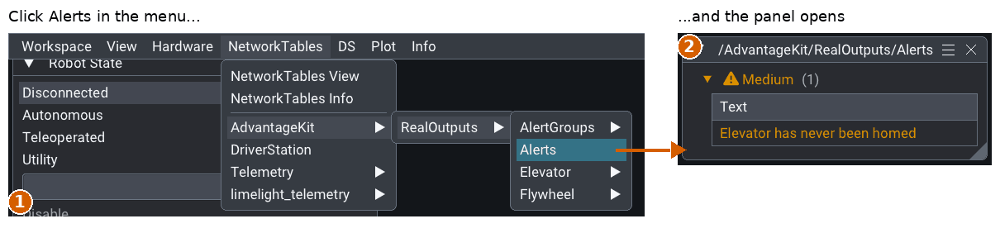

# Logging options and where they land

A log is the robot's record of what it read and what it decided, tick by tick, so you can watch
it live and look back at it afterwards. The course uses two ways to log, and each lands in a
different place.

The examples come from the course's final code, after
[Lesson 33](../../lessons/v3/33-tuning-with-sysid.md), unless they say otherwise, and each
one links to the lesson section where you write it. How a log is replayed is on the
[IO architecture](02-io-replay.md) page.

## 1. `Telemetry.log`: WPILib's way

From Lesson 3 to Lesson 12, every value goes out through WPILib's **`Telemetry.log(key,
value)`**. It publishes the value to NetworkTables, the robot's live data channel, under
`/Telemetry/<key>`; a slash in the key makes a folder. <!-- claim: wpilib.telemetry-log-publishes-under-telemetry -->

<!-- source: lesson-3 subsystems/DriveModule.java -->
*Example, from Lesson 3's `DriveModule.java` ([Lesson 3, section 4](../../lessons/v3/03-telemetry.md#4-what-to-log-and-where)):*
```java
private void logTelemetry() {
  double rotations = m_driveMotor.getPosition().getValue().in(Rotations);
  double rps = m_driveMotor.getVelocity().getValue().in(RotationsPerSecond);

  Telemetry.log("DriveModule/PositionRotations", rotations);
  Telemetry.log("DriveModule/VelocityRotPerSec", rps);
}
```

`DataLogManager.start()` copies everything published to NetworkTables into a file, the
**`WPILIB_` log**: in simulation it lands in the project's `logs/` folder, and on a real robot
on SystemCore or a USB stick plugged into it. <!-- claim: wpilib.datalogmanager-mirrors-published-values, wpilib.datalogmanager-real-robot-location -->
Live, SimGUI shows plain values in its **NetworkTables View** window, and AdvantageScope lists them
under **Telemetry**. <!-- claim: wpilib-tools.simgui-networktables-view, wpilib-tools.advantagescope-sidebar -->

<details class="quiz" id="q-logging-1" markdown="1">
<summary>Check yourself: where does `Telemetry.log("DriveModule/VelocityRotPerSec", rps)` publish?</summary>

- [x] `/Telemetry/DriveModule/VelocityRotPerSec`, with `DriveModule` as a folder. *The key goes under `/Telemetry`, and the slash makes a folder.*
- [ ] `/DriveModule/VelocityRotPerSec` *Everything `Telemetry.log` publishes is under `/Telemetry`.*
- [ ] Only into the log file, not live. *It publishes live; `DataLogManager` copies it into the file.*

</details>

<details class="quiz" id="q-logging-2" markdown="1">
<summary>Check yourself: you logged with `Telemetry.log` during a simulated run. Where is the record afterwards?</summary>

- [ ] Nowhere: `Telemetry.log` is live only. *`DataLogManager` saves what's published.*
- [x] In a `WPILIB_` file in the project's `logs/` folder, saved by `DataLogManager`. *It mirrors everything published to NetworkTables.*
- [ ] In an `akit_` file. *That's AdvantageKit's file, and it doesn't hold `Telemetry.log` values.*

</details>

## 2. AdvantageKit: inputs and outputs

From Lesson 13 the robot logs with **AdvantageKit**, which sorts everything into two kinds.

- An **input** is something the robot *read*: a sensor, a motor's current, the battery. A whole
  bundle of readings goes in with `Logger.processInputs(key, inputs)`.
- An **output** is something the robot *worked out*: a goal, a decision, a pose. Each goes in
  with `Logger.recordOutput(key, value)`.

<!-- source: lesson-33 subsystems/Elevator.java -->
*Example, from `Elevator.java` ([Lesson 18, section 8](../../lessons/v3/18-elevator.md#8-the-elevator-mechanism); later lessons add outputs):*
```java
/** One tick of sensing: read the hardware into the bundle and log it. */
private void periodic() {
  m_io.updateInputs(m_inputs);
  Logger.processInputs("Elevator", m_inputs); // every reading, under Elevator/
  Logger.recordOutput("Elevator/GoalMeters", m_goal.in(Meters));
  Logger.recordOutput("Elevator/HeightErrorMeters", m_inputs.heightMeters - m_goal.in(Meters));
  Logger.recordOutput("Elevator/AtGoal", atGoal());
  Logger.recordOutput("Elevator/Homed", m_homed);
  // ...
}
```

Each field of the inputs bundle is logged under the key, named after the field with its first
letter capitalized, so `heightMeters` becomes `Elevator/HeightMeters`. <!-- claim: advantagekit.autolog-key-names -->
Live, inputs are under `/AdvantageKit/<key>` and outputs under
`/AdvantageKit/RealOutputs/<key>`, and AdvantageScope shows them in an **AdvantageKit** folder. <!-- claim: advantagekit.data-receivers-and-files, wpilib-tools.advantagescope-advantagekit-tree -->

Why the split? A replay puts the recorded *inputs* back and works the *outputs* out again, so the
two have to be kept apart; the [replay](02-io-replay.md) page explains it. The rule of thumb: if
it came off hardware, it's an input; if your code computed it, it's an output. And log a decision
before you need it: Lesson 32's bug was invisible until `AtGoal` was recorded.

<details class="quiz" id="q-logging-3" markdown="1">
<summary>Check yourself: `Elevator/GoalMeters` is where the code wants the carriage. Input or output?</summary>

- [ ] An input: it's a number about the elevator. *Inputs are what the robot read from hardware.*
- [x] An output: the code decided it. *Record it with `recordOutput`.*
- [ ] Neither: goals aren't logged. *The elevator records its goal every tick.*

</details>

<details class="quiz" id="q-logging-4" markdown="1">
<summary>Check yourself: the elevator's inputs bundle has a field `statorCurrentAmps`. What's its log key?</summary>

- [ ] `Elevator/statorCurrentAmps` *The first letter is capitalized.*
- [x] `Elevator/StatorCurrentAmps` *The `processInputs` key, then the field's name with a capital.*
- [ ] `RealOutputs/Elevator/StatorCurrentAmps` *That's where an output would go; this is an input.*

</details>

## 3. Two log files, and what's in each

Since Lesson 13 a run leaves two files in `logs/`: <!-- claim: advantagekit.data-receivers-and-files, advantagekit.wpilib-log-saves-telemetry -->

| File | Written by | Holds |
|---|---|---|
| `akit_<date>.wpilog` | AdvantageKit | every input and every recorded output; the file a replay reads |
| `WPILIB_<date>.wpilog` | `DataLogManager` | everything published to NetworkTables outside AdvantageKit, plus a copy of AdvantageKit's outputs |

**AdvantageKit doesn't capture `Telemetry.log`.** <!-- claim: advantagekit.telemetry-log-not-recorded -->
So a value that's still published that way, like the field widget, B-Line's `FollowPath/` values
or Lesson 33's SysId signals, is only in the `WPILIB_` file, and isn't part of a replay. <!-- claim: advantagekit.wpilib-log-saves-telemetry -->
Open either file in AdvantageScope with **File → Open Log(s)**. <!-- claim: wpilib-tools.advantagescope-connect -->

<details class="quiz" id="q-logging-5" markdown="1">
<summary>Check yourself: you want to look at B-Line's `FollowPath/crossTrackError` after a run. Which file?</summary>

- [ ] The `akit_` file. *B-Line logs through `Telemetry`, which AdvantageKit doesn't capture.*
- [x] The `WPILIB_` file. *Everything published outside AdvantageKit is saved there.*
- [ ] Neither: B-Line's values are live only. *`DataLogManager` saves them.*

</details>

<details class="quiz" id="q-logging-6" markdown="1">
<summary>Check yourself: which file does a replay read?</summary>

- [x] The `akit_` file, because it holds the inputs. *A replay puts the recorded inputs back.*
- [ ] The `WPILIB_` file. *It doesn't hold AdvantageKit's inputs.*
- [ ] Both, merged. *A replay reads AdvantageKit's own recording.*

</details>

## 4. A drawing is logged like a number

The course draws things as well as logging numbers: the robot on the field, the elevator and arm,
the flywheel's dial. **Logging a drawing records it as it looks at that moment**; changing it
afterwards records nothing until it's logged again. <!-- claim: wpilib.telemetry-log-is-a-snapshot, advantagekit.logged-mechanism-recorded-each-tick -->
So a drawing is changed and logged every tick, like everything else:

<!-- source: lesson-33 subsystems/Elevator.java -->
*Example, from the end of `Elevator.java`'s `periodic()` ([Lesson 19, section 5](../../lessons/v3/19-mechanism2d.md#5-move-it-then-log-it)):*
```java
m_carriage.setLength(m_inputs.heightMeters);
m_carriage.setColor(
    atGoal() ? ElevatorConstants.kAtGoalColor : ElevatorConstants.kMovingColor);
Logger.recordOutput("Elevator/Mechanism", m_mechanism);
```

Record it once, in the constructor, and the drawing stays frozen where it started while the
numbers keep moving. <!-- claim: advantagekit.mechanism-record-once-freezes -->
The elevator's drawing is an AdvantageKit `LoggedMechanism2d`, so it replays like any output; the
field widget is WPILib's `Field2d`, logged with `Telemetry.log`, so it's only in the `WPILIB_`
file. <!-- claim: advantagekit.logged-mechanism-recorded-each-tick, advantagekit.telemetry-log-not-recorded -->

<details class="quiz" id="q-logging-7" markdown="1">
<summary>Check yourself: the elevator's drawing is recorded once, in its constructor. What do you see as the carriage moves?</summary>

- [ ] The drawing follows the carriage. *Recording takes a snapshot; nothing updates it afterwards.*
- [x] The drawing stays where it started, while the height numbers move. *Record the drawing every tick, right after changing it.*
- [ ] Nothing at all. *The first snapshot is there; it just never changes.*

</details>

<details class="quiz" id="q-logging-8" markdown="1">
<summary>Check yourself: why is `Logger.recordOutput("Elevator/Mechanism", ...)` the last line of the elevator's periodic?</summary>

- [x] The drawing has to be changed first; recording takes a snapshot of how it looks at that moment. *Change it, then log it.*
- [ ] Outputs must always be recorded last in a method. *Order only matters because the drawing changes above it.*
- [ ] So it runs after the scheduler. *It runs in the elevator's periodic, before any command.*

</details>

## 5. Alerts: saying something now

A log is a record, for afterwards. An **alert** is a statement about *now*, for someone standing
next to the robot: "the gyro isn't answering", "the battery is low". WPILib's `Alert` takes an id,
the text a person reads, and a level: **`HIGH`** (the robot is broken), **`MEDIUM`** (it works,
but something's off) or **`LOW`** (worth knowing). <!-- claim: wpilib.alert-duplicate-throws -->

<!-- source: lesson-33 subsystems/Elevator.java -->
*Example, from `Elevator.java` ([Lesson 30, section 6](../../lessons/v3/30-alerts.md#6-alerts-that-belong-to-a-subsystem)):*
```java
private final Alert m_disconnected =
    new Alert("Elevator/Disconnected", "Elevator motor is not on the CAN bus", Level.HIGH);
private final Alert m_notHomed =
    new Alert("Elevator/NotHomed", "Elevator has never been homed", Level.MEDIUM);
// ...
// Set every tick, not raised once: an alert is a statement about how
// things are now, so it has to be able to go away again.
m_disconnected.set(!m_inputs.motorConnected);
m_notHomed.set(!m_homed);
```

**The habit that matters: `set` it every tick with the current answer.** Then the alert goes away
by itself when somebody plugs the cable back in. Each id has to be unique: a second alert with the
same id and level throws when it's built. Borrowing a log key's shape keeps them unique. <!-- claim: wpilib.alert-duplicate-throws -->

Where they show: AdvantageKit records every alert as outputs under `Alerts`, and SimGUI draws that
as an alerts panel, as Figure 30.1 shows. SimGUI also has its own **DS → Alerts** window, and on a
real robot the 2027 Driver Station shows them. <!-- claim: advantagekit.records-wpilib-alerts, wpilib-tools.simgui-ds-alerts-window, wpilib-tools.driverstation-2027-shows-alerts -->



*Figure 30.1, from [Lesson 30](../../lessons/v3/30-alerts.md#figure-30-1) — The path to the alerts panel (1), and the panel (2) on a fresh launch.* <!-- claim: advantagekit.records-wpilib-alerts -->

<details class="quiz" id="q-logging-9" markdown="1">
<summary>Check yourself: the gyro's alert is written as `if (!connected) { alert.set(true); }`. The cable is unplugged and plugged back in. What does the panel show?</summary>

- [ ] Nothing now: the gyro is back. *Nothing ever sets it false again.*
- [x] The gyro alert, still up, although the gyro is fine. *Set it every tick with the current answer so it can clear.*
- [ ] Two gyro alerts. *It's one alert, set true and never cleared.*

</details>

<details class="quiz" id="q-logging-10" markdown="1">
<summary>Check yourself: which level fits "Elevator motor is not on the CAN bus"?</summary>

- [x] `HIGH`: the robot can't do its job. *A missing motor means broken.*
- [ ] `MEDIUM`: it works, but something is off. *Without the motor the elevator doesn't work at all.*
- [ ] `LOW`: worth knowing. *It's far worse than that.*

</details>

## 6. When an alert should speak up

Setting an alert every tick doesn't mean setting it to the raw reading. Sometimes the condition
needs a qualifier. A battery under load always reads low, so "the battery is flat" is only judged
while the robot is disabled, when the voltage at rest is what it says:

<!-- source: lesson-33 Robot.java -->
*Example, from `Robot.java`'s `robotPeriodic()` ([Lesson 30, section 10](../../lessons/v3/30-alerts.md#10-the-alert-nothing-owns)):*
```java
m_lowBattery.set(
    RobotState.isDisabled() && power.batteryVolts < PowerConstants.kLowBatteryVoltage.in(Volts));
```

Without the `isDisabled()` gate, enabling the robot on a fresh simulated battery sags the rail
below the alert's 11.5 V line for about 0.7 s while the flywheel spins up, a false alarm. <!-- claim: l30.enable-dip-time -->

And sometimes you *want* an alert to stay up: "this robot browned out at some point since it was
switched on" is worth knowing after the voltage has recovered. That's a **sticky** alert, set
true once and never cleared until restart, on purpose. Lesson 30's last Try It builds one. The
difference from the bug in the quiz above is only whether it was meant.

<details class="quiz" id="q-logging-11" markdown="1">
<summary>Check yourself: why is the low-battery alert only judged while the robot is disabled?</summary>

- [ ] The battery can't be read while enabled. *It's read every tick.*
- [x] Under load the voltage always sags, so a reading while driving would raise false alarms; the voltage at rest is what says the battery is flat. *Gate the alert on the moment its reading means something.*
- [ ] Alerts can only change while disabled. *They're set every tick, enabled or not.*

</details>

<details class="quiz" id="q-logging-12" markdown="1">
<summary>Check yourself: when is a sticky alert, one that never clears, the right choice?</summary>

- [ ] Never: every alert must be set from the current reading. *That's the usual habit, not a law.*
- [x] When the fact is about the past and still matters, like "browned out since power-on". *It stays up after the voltage recovers, on purpose.*
- [ ] For every `HIGH` alert. *A missing motor that comes back should clear.*

</details>

## Common mistakes

- **Logging a reading with `recordOutput`**, or a decision with `processInputs`. Readings are
  inputs; what the code works out is an output ([section 2](#2-advantagekit-inputs-and-outputs)).
- **Looking for a `Telemetry.log` value in the `akit_` file.** It's in the `WPILIB_` file.
- **Logging a drawing once.** It's a snapshot; log it every tick after changing it.
- **Raising an alert once** when it should describe now. Set it every tick.
- **Two alerts with the same id and level.** The second throws when it's built.
- **An alert that fires during normal use**, like low voltage under load. Gate it on when the
  reading means something.

## Where this comes from

- **[Lesson 3](../../lessons/v3/03-telemetry.md):** `Telemetry.log`, `DataLogManager` and
  AdvantageScope.
- **[Lesson 11](../../lessons/v3/11-odometry-field.md):** the field widget.
- **[Lesson 13](../../lessons/v3/13-io-replay.md):** AdvantageKit's inputs and outputs, and the
  two files.
- **[Lesson 19](../../lessons/v3/19-mechanism2d.md):** a drawing logged like a number.
- **[Lesson 30](../../lessons/v3/30-alerts.md):** alerts.
- **[Lesson 32](../../lessons/v3/32-reading-a-log.md):** reading a log, and logging the decision
  you'll need.
- **[Lesson 33](../../lessons/v3/33-tuning-with-sysid.md):** SysId's signals in the `WPILIB_`
  file.

## Quick reference

| You write | Where it lands |
|---|---|
| `Telemetry.log("Key", value)` | live under `/Telemetry/Key`; saved in the `WPILIB_` file |
| `Logger.processInputs("Key", inputs)` | an input: live under `/AdvantageKit/Key/<Field>`; in the `akit_` file |
| `Logger.recordOutput("Key", value)` | an output: live under `/AdvantageKit/RealOutputs/Key`; in the `akit_` file |
| `DataLogManager.start()` | saves everything published to NetworkTables in a `WPILIB_` file |
| `new Alert(id, text, Level.HIGH)` | an alert; ids must be unique per level |
| `alert.set(condition)` | every tick, with the current answer |
