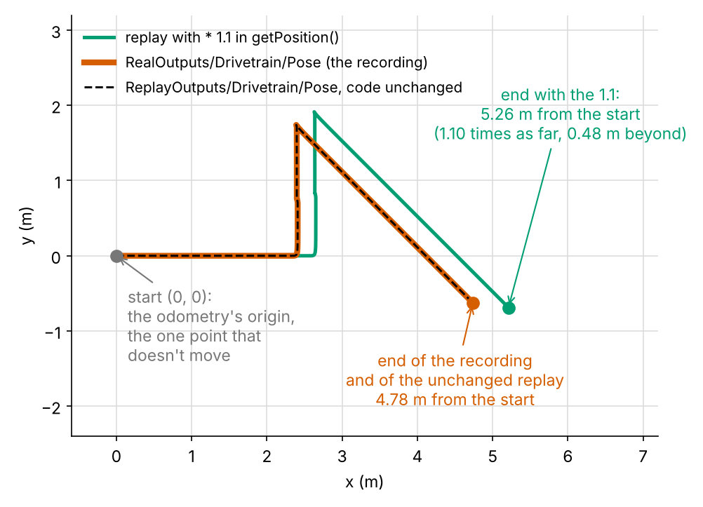

# IO architecture for logging and replay

The course puts every piece of hardware behind a small "door", an IO class, so the robot's logic
never touches a motor or sensor directly. That one choice lets the same logic run on a real robot,
in the simulator, or on a recorded match played back.

The examples come from the course's final code, after
[Lesson 33](../../lessons/v3/33-tuning-with-sysid.md), unless they say otherwise, and each
one links to the lesson section where you write it. What gets logged, and where, is on the
[Logging options](01-logging.md) page.

## 1. Hardware behind a door

Each mechanism's hardware is described by an **IO interface** with two halves: an **inputs**
bundle, every reading the hardware can give, filled by `updateInputs`; and a few commands for
what the hardware can be told to do.

<!-- source: lesson-33 subsystems/ElevatorIO.java -->
*Example, from `ElevatorIO.java` ([Lesson 18, section 5](../../lessons/v3/18-elevator.md#5-the-contract-elevatorio); Lesson 13 sets up the pattern for the drivetrain):*
```java
public interface ElevatorIO {
  @AutoLog
  public static class ElevatorIOInputs {
    public double heightMeters = 0.0;
    public double velocityMetersPerSec = 0.0;
    public double appliedVolts = 0.0;
    public double setpointMeters = 0.0; // the profile's instantaneous target, not the final goal
    public double statorCurrentAmps = 0.0;
    public double supplyCurrentAmps = 0.0;
    public boolean atBottomLimit = false;
    public boolean motorConnected = false;
  }

  /** Read every sensor into 'inputs'. Called once per tick, before anything else. */
  public default void updateInputs(ElevatorIOInputs inputs) {}

  /** Firmware Motion Magic position control, in meters of carriage height. */
  public default void setGoalHeightMeters(double meters) {}
  // ...
}
```

Three classes can stand behind the door, and Figure 13.1 maps them for the drivetrain: one for
the real hardware (`...IOTalonFX`), one for the simulator (`...IOSim`), and an empty one for
replay. The mechanism's own class, `Elevator` here, holds an `ElevatorIO` and never knows which.

![A map of the IO layer. On the left, SwerveModule holds a ModuleIO and its inputs bundle and owns no motors. In the middle, the ModuleIO interface has two lists: inputs, the readings steerAngleDegrees, drivePositionMeters and driveVelocityMetersPerSec filled by updateInputs, and commands, setSteerAngleDegrees and setDriveVelocityMetersPerSec. On the right, ModuleIOTalonFX for the real robot, ModuleIOSim for simulation and an empty ModuleIO for replay, one of which Drivetrain's makeModule switch picks.](../../lessons/v3/images/13-io-door.svg)

*Figure 13.1, from [Lesson 13](../../lessons/v3/13-io-replay.md#figure-13-1) — One door per sensor: the logic on one side, three things that can stand on the other.*

<details class="quiz" id="q-ioreplay-1" markdown="1">
<summary>Check yourself: which class in the final code calls `TalonFX` methods for the elevator?</summary>

- [ ] `Elevator` *It holds an `ElevatorIO` and never touches a motor.*
- [x] `ElevatorIOTalonFX` (and `ElevatorIOSim`, which extends it). *The hardware lives behind the door.*
- [ ] `ElevatorIO` *It's the interface: it says what can be done, not how.*

</details>

<details class="quiz" id="q-ioreplay-2" markdown="1">
<summary>Check yourself: a new sensor reading is added to the elevator. Where does it go?</summary>

- [x] A field in `ElevatorIOInputs`, filled in by `updateInputs`. *Every reading belongs in the inputs bundle, so it's logged and replayed.*
- [ ] A field in `Elevator`, read straight from the hardware. *Then it would bypass the door, and a replay couldn't put it back.*
- [ ] A `recordOutput` line. *Readings are inputs, not outputs.*

</details>

## 2. Picking what stands behind the door

One constant decides which world the robot is in, and each mechanism picks its IO class from it:

<!-- source: lesson-33 subsystems/Elevator.java -->
*Example, from `Elevator.java` ([Lesson 18, section 8](../../lessons/v3/18-elevator.md#8-the-elevator-mechanism)):*
```java
private final ElevatorIO m_io = switch (Constants.kCurrentMode) {
  case REAL -> new ElevatorIOTalonFX();
  case SIM -> new ElevatorIOSim();
  case REPLAY -> new ElevatorIO() {}; // inputs come from the log
};
private final ElevatorIOInputsAutoLogged m_inputs = new ElevatorIOInputsAutoLogged();
```

`kCurrentMode` is `REAL` on a robot, and in simulation whatever `kSimMode` says: `SIM` normally,
`REPLAY` to play a recording back. The replay case is an empty class: nothing behind the door,
because the readings will come out of the log.

`ElevatorIOInputsAutoLogged` is a class nobody typed. `@AutoLog` on the inputs bundle makes
AdvantageKit's annotation processor write it at compile time, a subclass that knows how to write
every field into a log and read it back. <!-- claim: advantagekit.autolog-generates-class -->
The [Annotations](../java/06-annotations.md#4-autolog-a-tool-writes-code-for-you) page explains
how.

<details class="quiz" id="q-ioreplay-3" markdown="1">
<summary>Check yourself: in a replay, what stands behind the elevator's door?</summary>

- [ ] `ElevatorIOSim`, re-running the physics. *A replay doesn't simulate anything.*
- [x] An empty `ElevatorIO`: the readings come from the log instead. *Its commands do nothing, and `updateInputs` fills nothing.*
- [ ] `ElevatorIOTalonFX`, talking to no motor. *The real class is only built on a real robot.*

</details>

<details class="quiz" id="q-ioreplay-4" markdown="1">
<summary>Check yourself: where does `ElevatorIOInputsAutoLogged` come from?</summary>

- [ ] You write it in Lesson 18. *Nobody types it.*
- [x] AdvantageKit's annotation processor generates it at compile time from `@AutoLog`. *It knows how to log every field and read it back.*
- [ ] It's in WPILib. *It's generated for your own class.*

</details>

## 3. Record, then replay

Here's what the door buys. Every tick, the mechanism's periodic does the same two lines:

<!-- source: lesson-33 subsystems/Elevator.java -->
*Example, from `Elevator.java`'s `periodic()` ([Lesson 18, section 8](../../lessons/v3/18-elevator.md#8-the-elevator-mechanism)):*
```java
m_io.updateInputs(m_inputs);
Logger.processInputs("Elevator", m_inputs); // every reading, under Elevator/
```

**When recording**, `updateInputs` fills the bundle from the hardware, and `processInputs` writes
it to the log. **When replaying**, `updateInputs` does nothing, and `processInputs` *reads the
bundle back out of the log*. <!-- claim: advantagekit.autolog-key-names -->
Everything after those two lines, your logic, runs exactly as it did, on exactly the same
readings, and works its outputs out again. Figure 13.2 draws the two runs side by side.

![Two columns of boxes. Record: the real motors or the simulator feed updateInputs, which fills the inputs, which are logged; your logic works out outputs, recorded as RealOutputs; commands go to the IO. Replay: the motors and simulator are not running; the inputs are read back from the log file by processInputs; your logic, as it is today, works out the outputs again as ReplayOutputs; the commands go nowhere. A blue arrow carries the inputs from the recording to the replay, and a dashed orange arrow marks the two outputs that get compared.](../../lessons/v3/images/13-record-replay.svg)

*Figure 13.2, from [Lesson 13](../../lessons/v3/13-io-replay.md#figure-13-2) — Record, then replay: the inputs come out of the file, and the outputs are worked out again.*

A replay's file holds the recorded inputs, the recording's outputs under `RealOutputs`, and the
outputs worked out again under `ReplayOutputs`, including outputs for code written after the
recording. <!-- claim: advantagekit.replay-file-layout -->
The robot's own loop replays too: the clock, the joysticks, enabled or disabled and the selected
opmode are captured each tick and put back, so even a timer or a debounce decides what it decided
before. <!-- claim: advantagekit.logged-opmode-robot-captures-ds, advantagekit.replay-clock -->

That's what makes it useful. **Replay runs today's code on a recorded match**: fix a bug, replay
the match where it happened, and see whether the fix would have worked. Change something that
only affects the outputs, and the replayed outputs change; Figure 13.4 shows a ×1.1 slipped into
the pose math stretching the replayed path. <!-- claim: l13.fig-recording-distance -->



*Figure 13.4, from [Lesson 13](../../lessons/v3/13-io-replay.md#figure-13-4) — One recorded drive, replayed twice: the unchanged code lands on the recording; the code with `* 1.1` draws the same shape, stretched.* <!-- claim: l13.fig-recording-distance, l13.fig-scaled-distance -->

<details class="quiz" id="q-ioreplay-5" markdown="1">
<summary>Check yourself: you add a `* 1.1` inside `ModuleIOTalonFX.updateInputs` and replay an old recording. Does the replayed pose change?</summary>

- [ ] Yes, by 10%. *The IO class isn't even built in a replay.*
- [x] No: in a replay the readings come from the log, so the IO class's code never runs. *A bug in the readings is in the recording itself.*
- [ ] The replay refuses to run. *It runs; the change just has no effect.*

</details>

<details class="quiz" id="q-ioreplay-6" markdown="1">
<summary>Check yourself: you add a new output, `Elevator/HeightErrorMeters`, after a match was recorded. Can a replay of that match show it?</summary>

- [x] Yes: the replay works it out from the recorded inputs and writes it under `ReplayOutputs`. *Outputs are recomputed, so new ones appear.*
- [ ] No: only values that were in the recording can appear. *That's true of inputs, not outputs.*
- [ ] Only under `RealOutputs`. *`RealOutputs` holds what the recording itself worked out.*

</details>

## 4. What counts as an input

The rule is simple to say and easy to miss: **anything the code reads from outside itself has to
be recorded as an input**, or a replay can't put it back. The two cases the course had to think
about:

- **The battery voltage.** AdvantageKit doesn't replay `RobotController.getBatteryVoltage()`, so
  the course reads it into its own small inputs bundle. <!-- claim: advantagekit.battery-voltage-not-replayed -->
- **Where the robot was set down at boot.** The simulator knows; a real robot doesn't. So it's
  recorded, as "known" or not, and a replay reads whichever the run recorded.

<!-- source: lesson-33 Robot.java -->
*Example, from `Robot.java`'s `robotPeriodic()` ([Lesson 29, section 6](../../lessons/v3/29-current-limits.md#6-simulating-the-battery)):*
```java
// The battery's voltage is a reading, like a sensor's, so it's recorded as
// one: a replay gets the voltage the robot really had, not a fresh guess.
PowerReadingsAutoLogged power = new PowerReadingsAutoLogged();
power.batteryVolts = RobotController.getBatteryVoltage();
Logger.processInputs("Power", power);
```

<!-- source: lesson-33 Robot.java -->
*Example, from `Robot.java`'s constructor ([Lesson 16, section 7](../../lessons/v3/16-ground-truth.md#7-closing-the-loop-vision-checks-itself-against-truth)):*
```java
StartingPlacementAutoLogged placement = new StartingPlacementAutoLogged();
if (Constants.kCurrentMode == Constants.Mode.SIM) {
  placement.known = true;
  placement.pose = DriveConstants.kSimStartingPose;
}
Logger.processInputs("StartingPlacement", placement);
if (placement.known) {
  localizer.resetPose(placement.pose); // instead of guessing (0, 0, 0°)
}
```

The second one reads oddly at first: in a replay `kCurrentMode` is `REPLAY`, so the `if` doesn't
fill anything, and `processInputs` fills `placement` from the log instead. That works even in the
constructor, because AdvantageKit has already loaded the recording's first tick by then. <!-- claim: advantagekit.replay-loads-first-tick-in-constructor -->

<details class="quiz" id="q-ioreplay-7" markdown="1">
<summary>Check yourself: why is the battery voltage logged with `processInputs` and not `recordOutput`?</summary>

- [x] It's a reading from outside the code, and AdvantageKit doesn't replay it by itself, so it has to be recorded as an input to come back in a replay. *An output would be recomputed, from a different battery.*
- [ ] `recordOutput` can't take a `double`. *It takes doubles.*
- [ ] Battery values are too big for outputs. *Size has nothing to do with it.*

</details>

<details class="quiz" id="q-ioreplay-8" markdown="1">
<summary>Check yourself: in a replay of a simulated run, `kCurrentMode` is `REPLAY`. Where does `placement.known` get its value?</summary>

- [ ] From the `if`, which sets it true. *The `if` only runs in `SIM`.*
- [x] From the log: `processInputs` reads back what the recorded run wrote. *So a replay starts the estimate wherever the run did.*
- [ ] It stays false, so the replay starts at (0, 0). *It reads the recording's value, true for a simulated run.*

</details>

## 5. Running a replay, and what it can't do

To replay: set `kSimMode` to `Mode.REPLAY`, then name the recording and run. <!-- claim: advantagekit.find-replay-log-sources -->

*Nothing to add — these are Lesson 13's replay steps:*
```powershell
$env:AKIT_LOG_PATH = "logs\akit_26-10-28_12-53-05.wpilog"   # your file's name
./gradlew run
```

No window opens: a replay refuses to run with SimGUI loaded, so the project's `build.gradle`
leaves SimGUI out while `AKIT_LOG_PATH` is set. <!-- claim: advantagekit.replay-needs-no-sim-gui -->
Without the variable, AdvantageKit uses the log AdvantageScope has open, and if there's none it
asks. `./gradlew replayWatch` sets the variable itself, and VS Code's **Simulate Robot Code** works
too, with **Sim GUI** unticked. <!-- claim: advantagekit.find-replay-log-sources, advantagekit.vscode-simulate-extension-prompt -->
Afterwards, remove the variable and put `kSimMode` back to `SIM`.

What a replay can't do:

- **Bring back what wasn't recorded.** `Telemetry.log` values aren't in AdvantageKit's file, so
  they aren't replayed. <!-- claim: advantagekit.telemetry-log-not-recorded -->
- **Move anything.** The commands sent to the IO go nowhere.
- **Fix a bug in the readings.** A wrong reading is in the recording; only the logic after it can
  be changed and re-run.
- **Match every tick exactly.** Picking an opmode and the moment of disabling can replay one tick
  early. <!-- claim: advantagekit.replay-matches-recording -->

Lesson 32 puts it all together: a bug that kept `AtGoal` false is found in a recorded match, fixed,
and the same match replayed through the fixed code. Figure 32.2 shows the replayed `AtGoal` coming
true.


*Figure 32.2, from [Lesson 32](../../lessons/v3/32-reading-a-log.md#figure-32-2) — The same recorded match through the fixed code: the readings are identical, the replayed `AtGoal` is true from 1.26 s.* <!-- claim: l32.replay-true-for-good -->

<details class="quiz" id="q-ioreplay-9" markdown="1">
<summary>Check yourself: you set `AKIT_LOG_PATH` and run, and SimGUI doesn't appear. Is something broken?</summary>

- [ ] Yes: SimGUI should always open. *A replay refuses to run with it.*
- [x] No: while the variable is set, the build leaves SimGUI out on purpose, because replay can't run with it. *Remove the variable afterwards, or SimGUI stays off.*
- [ ] Only if the log file is missing. *It's the variable, not the file.*

</details>

<details class="quiz" id="q-ioreplay-10" markdown="1">
<summary>Check yourself: B-Line's `FollowPath/crossTrackError` is logged with `Telemetry.log`. Can you see a replayed version of it?</summary>

- [ ] Yes, under `ReplayOutputs`. *Only AdvantageKit outputs are recomputed there.*
- [x] No: it isn't recorded by AdvantageKit, so it isn't replayed. *It's only in the live run's `WPILIB_` file.*
- [ ] Yes, under `RealOutputs`. *`RealOutputs` holds the recording's AdvantageKit outputs.*

</details>

## Common mistakes

- **Reading hardware outside the IO class.** A replay can't put that reading back
  ([section 1](#1-hardware-behind-a-door)).
- **Recording a reading as an output.** A replay recomputes it, from nothing it recorded.
- **Building a subsystem before logging starts.** It could read the clock or a joystick unrecorded;
  `Robot` starts logging in an initializer block above every field. <!-- claim: advantagekit.start-from-instance-initializer -->
- **Forgetting to put `kSimMode` and `AKIT_LOG_PATH` back.** The next run replays, and SimGUI
  stays off.
- **Expecting a replay to fix a sensor bug.** The bug is in the recording.

## Where this comes from

- **[Lesson 13](../../lessons/v3/13-io-replay.md):** the IO layer, the three modes, AdvantageKit,
  and recording and replaying.
- **[Lesson 15](../../lessons/v3/15-limelight.md):** a camera behind its own door.
- **[Lesson 16](../../lessons/v3/16-ground-truth.md):** the starting placement as an input.
- **[Lesson 18](../../lessons/v3/18-elevator.md):** the elevator's IO, the pattern again.
- **[Lesson 29](../../lessons/v3/29-current-limits.md):** the battery voltage as an input.
- **[Lesson 32](../../lessons/v3/32-reading-a-log.md):** proving a fix with replay.

## Quick reference

| You write | What it does |
|---|---|
| `interface ElevatorIO` with `@AutoLog class ElevatorIOInputs` | the door: readings in, commands out |
| `ElevatorIOTalonFX`, `ElevatorIOSim`, `new ElevatorIO() {}` | real hardware, the simulator, nothing (replay) |
| `switch (Constants.kCurrentMode)` | pick which stands behind the door |
| `m_io.updateInputs(m_inputs)` | fill the readings (does nothing in replay) |
| `Logger.processInputs("Key", m_inputs)` | log the readings, or read them back in replay |
| `kSimMode = Mode.REPLAY` and `AKIT_LOG_PATH` | replay a recording |
| `./gradlew replayWatch` | replay the log AdvantageScope has open |
