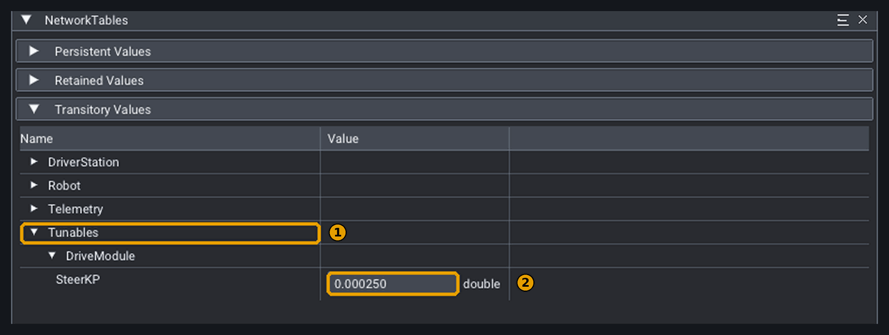

# Tunables: changing values while the robot runs

A **tunable** is a number the robot publishes so that SimGUI, or any dashboard, can change it while
the robot runs. The course uses them for every value worth tuning: gains, tolerances, profile
limits and the power budget. Each one starts from its constant in `Constants.java`, and a number
worth keeping goes back there.

The examples come from the course's final code, after
[Lesson 33](../../lessons/v3/33-tuning-with-sysid.md), unless they say otherwise, and each
one links to the lesson section where you write it. How tunables sit with recording and replay is
in [section 6](#6-tuning-and-replay), and the logs themselves are on the
[Logging options](01-logging.md) page.

## 1. A number you can change

The smallest tunable is one line, and the code reads it with `get()` every time it uses it:

<!-- source: lesson-5 subsystems/DriveModule.java -->
*Example, from `DriveModule.java` ([Lesson 5, section 5](../../lessons/v3/05-steering-p-control.md#5-bind-it-and-tune-kp); Lesson 7 replaces `DriveModule`):*
```java
private final TunableDouble m_steerKP =
    Tunables.addDouble("DriveModule/SteerKP", SteerConstants.kP);
// ...
double output = m_steerKP.get() * error;      // push proportional to error
```

It's published under `/Tunables/DriveModule/SteerKP`, and SimGUI shows it in the
**NetworkTables View** window under **Transitory Values → Tunables**, as a box you can type a
new number into. <!-- claim: wpilib.tunables-publish-under-tunables, wpilib-tools.simgui-edits-tunables -->
A new value doesn't arrive at once: the robot takes it in once a tick, after `robotPeriodic()`,
so the code sees it on the next tick. <!-- claim: wpilib.tunables-applied-on-update, wpilib.tunables-update-after-robot-periodic -->



*Figure 5.3, from [Lesson 5](../../lessons/v3/05-steering-p-control.md#figure-5-3) — The Tunables folder in SimGUI's NetworkTables window (1), and `SteerKP` changed while the robot runs (2).* <!-- claim: wpilib-tools.simgui-edits-tunables -->

**Read it where you use it.** Copy `m_steerKP.get()` into a field in the constructor and the code
would keep the first value for good, whatever SimGUI says.

<details class="quiz" id="q-tunables-1" markdown="1">
<summary>Check yourself: you type a new `SteerKP` into SimGUI and press Enter. When does `m_steerKP.get()` return it?</summary>

- [ ] Immediately, on the line after you press Enter. *The robot takes dashboard changes in once a tick.*
- [x] On the next tick: the robot applies dashboard changes once a tick, after `robotPeriodic()`. *So the steering loop uses it from then on.*
- [ ] After the robot restarts. *A restart throws the change away: the tunable starts from the constant again.*

</details>

<details class="quiz" id="q-tunables-2" markdown="1">
<summary>Check yourself: you find a `SteerKP` you like. What do you do so the robot keeps it?</summary>

- [ ] Nothing: SimGUI remembers it. *The tunable starts from `SteerConstants.kP` every time the robot starts.*
- [x] Copy it into `SteerConstants.kP` in `Constants.java`. *The constant is the truth; the tunable only starts from it.*
- [ ] Call `set` on the tunable in the constructor. *That hides the real value in a second place.*

</details>

## 2. Where a tunable lives

**Make a tunable in something that's built once.** A mechanism, `Drivetrain` and `Robot` are built
once, when the robot starts. An opmode isn't: it's rebuilt on every Disable. A second tunable with
a name that's taken doesn't replace the first: an alert says the name is taken, and dashboard
changes keep going to the first one. <!-- claim: wpilib.tunables-duplicate-name-alert -->

**One value, one knob.** The four swerve modules share one steering gain, so from Lesson 7 it's a
`static` field: one tunable for the class, however many modules there are. Lesson 12 moves it into
`Drivetrain`, which sends it to all four. The aim's gain is static for a different reason:

<!-- source: lesson-33 commands/Aim.java -->
*Example, from `Aim.java` ([Lesson 27, section 2](../../lessons/v3/27-aim-at-tag.md#2-a-heading-you-can-compute)):*
```java
private static final TunableDouble s_aimP = Tuning.number("Aim/P", PathConstants.kAimP);
private static final Supplier<Angle> s_aimTolerance =
    Tuning.value("Aim/Tolerance", PathConstants.kAimTolerance, Degrees);
```

`Aim` is never built, so there's no object to hold them. Java sets up a class's `static` fields
the first time something uses the class, so these two appear in SimGUI only once the robot first
aims. <!-- claim: l27.aim-tunables-on-first-use -->

**Names are log-key shaped**, `Owner/What`: `Elevator/KG`, `Drivetrain/ToPose/AlignP`,
`Power/StatorLimit`.

<details class="quiz" id="q-tunables-3" markdown="1">
<summary>Check yourself: why not make the flywheel's gains tunables in `RobotTeleop`'s constructor?</summary>

- [ ] Opmodes can't read `Constants`. *They can; that's not the problem.*
- [x] The opmode is rebuilt on every Disable, and the second tunable with a taken name is refused. *SimGUI would keep talking to the first, dead one.*
- [ ] Tunables only work in classes that implement `Mechanism`. *`Robot` and the static `Aim` have them too.*

</details>

<details class="quiz" id="q-tunables-4" markdown="1">
<summary>Check yourself: the robot has just started, and **Tunables → Aim** isn't in SimGUI. Why?</summary>

- [ ] Aiming tunables are only published in autonomous. *Nothing about them depends on the mode.*
- [x] They're `static` fields, set up the first time something uses `Aim`, and nothing has aimed yet. *Hold the aim trigger once and they appear.*
- [ ] `kTuningMode` is false. *A locked tunable is still published; it just ignores changes.*

</details>

## 3. One helper, and a lock

From Lesson 12 every tunable is made by a small class, `Tuning`, so a rule about all of them has
one place to live. Lesson 18 puts one there: a robot at an event shouldn't be tunable, because a
stray click could change a gain mid-match.

<!-- source: lesson-33 Tuning.java -->
*Example, from `Tuning.java` ([Lesson 18, section 10](../../lessons/v3/18-elevator.md#10-tune-it-while-it-runs)):*
```java
private static TunableConfig config() {
  return new TunableConfig().withMutable(Constants.kTuningMode);
}

/** A tunable number, published under 'name', that starts at 'initial'. */
public static TunableDouble number(String name, double initial) {
  TunableDouble tunable = TunableDouble.createConfig(initial, config());
  Tunables.publish(name, tunable);
  return tunable;
}
```

With `Constants.kTuningMode` false, every tunable is still published, so its value still shows,
but a dashboard's new number is ignored: the value doesn't change, and nothing it would have
triggered runs. <!-- claim: wpilib.tunables-immutable --> Set it false before an event.

<details class="quiz" id="q-tunables-5" markdown="1">
<summary>Check yourself: `kTuningMode` is false and someone types a new `Elevator/KP` into the dashboard. What happens?</summary>

- [ ] The robot refuses to start. *The flag only decides whether changes are taken.*
- [ ] The new gain reaches the motor. *A locked tunable ignores the write.*
- [x] Nothing: the value still shows, but the write is ignored, and the gain isn't sent. *That's the point of the lock.*

</details>

<details class="quiz" id="q-tunables-6" markdown="1">
<summary>Check yourself: why does one change in `Tuning` lock every tunable in the robot?</summary>

- [x] Every tunable is made through `Tuning`, and every maker starts from `config()`. *B-Line's gains from Lesson 17 included.*
- [ ] `withMutable` is a global setting. *It's part of each tunable's own configuration.*
- [ ] Tunables made with `Tunables.addDouble` are locked too. *They don't go through `config()`, which is why the course stops using it after Lesson 12.*

</details>

## 4. Gains that live in the motor

A gain your own code multiplies by takes effect on the next tick. A gain that lives in a motor
controller doesn't, because the motor runs its own loop: the new number has to be sent there. A
tunable's **`onTune`** is code that runs each time a dashboard changes it, once per change. <!-- claim: wpilib.tunables-ontune-once-per-change -->

<!-- source: lesson-33 subsystems/Elevator.java -->
*Example, from `Elevator.java` ([Lesson 18, section 10](../../lessons/v3/18-elevator.md#10-tune-it-while-it-runs)):*
```java
private final TunableDouble m_kG =
    Tuning.number("Elevator/KG", ElevatorConstants.kElevatorKG, this::sendGains);
// ...
private void sendGains() {
  m_io.setGains(m_kG.get(), m_kV.get(), m_kA.get(), m_kP.get());
}
```

The IO class sends them as one config group:

<!-- source: lesson-33 subsystems/ElevatorIOTalonFX.java -->
*Example, from `ElevatorIOTalonFX.java` ([Lesson 18, section 10](../../lessons/v3/18-elevator.md#10-tune-it-while-it-runs)):*
```java
Slot0Configs slot0 = new Slot0Configs();
slot0.kG = kG;
slot0.GravityType = GravityTypeValue.Elevator_Static; // the slot's setting too, so send it
slot0.kV = kV;
slot0.kA = kA;
slot0.kP = kP;
m_motor.getConfigurator().apply(slot0);
```

Applying a `Slot0Configs` changes the slot and leaves the rest of the motor's configuration alone:
inversion, soft limits, current limits. But it sets *every* setting in the slot, so a gain left
out goes to zero. That's why all four gains, and the gravity type, go together. <!-- claim: phoenix6.slot0-apply-keeps-other-config -->
Current limits work the same way with a `CurrentLimitsConfigs`, which is why Lesson 29 keeps the
whole power budget in `Robot` and sends every motor both its limits at once. <!-- claim: l29.budget-tunables-reach-motors -->

<details class="quiz" id="q-tunables-7" markdown="1">
<summary>Check yourself: `sendGains` sent only `kP` in its `Slot0Configs`. What would go wrong?</summary>

- [ ] Nothing: the motor keeps the other gains. *A config group sets every setting in it.*
- [x] `kG`, `kV` and `kA` would be set to zero, and the elevator would sag and lag. *So the whole slot goes together.*
- [ ] The soft limits would turn off. *A `Slot0Configs` doesn't touch them.*

</details>

<details class="quiz" id="q-tunables-8" markdown="1">
<summary>Check yourself: why does `Elevator/Tolerance` have no `onTune`?</summary>

- [x] Nothing in the motor uses it: `atGoal()` reads it with `get()` each time. *Only a value that lives somewhere else needs sending there.*
- [ ] A tolerance can't be changed while the robot runs. *It can; `atGoal()` sees the new one on the next tick.*
- [ ] Measures can't have an `onTune`. *`Elevator/MaxVelocity` is a measure with one.*

</details>

## 5. Somebody else's number, and measures

Some values already live in an object with a getter and a setter, like a `PIDController`'s P. A
getter/setter tunable publishes what the getter says and hands a new value to the setter, so
there's no second copy to keep in step: <!-- claim: wpilib.tunables-getter-setter -->

<!-- source: lesson-33 commands/Autos.java -->
*Example, from `Autos.java` ([Lesson 17](../../lessons/v3/17-bline-autos.md)):*
```java
Tuning.property("Paths/TranslationP", translation::getP, translation::setP);
Tuning.property("Paths/RotationP", rotation::getP, rotation::setP);
Tuning.property("Paths/CrossTrackP", crossTrack::getP, crossTrack::setP);
```

A **measure** can be a tunable too, through `Tuning.value`, a generic method that takes the unit
to show it in. On a dashboard it's a plain number in that unit, and the code gets back a
`Supplier` of the measure, converted from that unit on each `get()`: <!-- claim: l18.tuning-value-display-unit -->

<!-- source: lesson-33 subsystems/Arm.java -->
*Example, from `Arm.java` ([Lesson 20, section 7](../../lessons/v3/20-intake-arm.md#7-the-arm-mechanism)):*
```java
private final Supplier<Angle> m_tolerance =
    Tuning.value("Arm/Tolerance", ArmConstants.kTolerance, Degrees);
```

So the arm's tolerance reads `2`, in degrees, and the flywheel's idle speed `30`, in rotations per
second: each in the unit its constant is written in. (WPILib can make a measure tunable on its
own, but it shows the base unit, radians for an angle, so a 2° tolerance would read `0.0349`.) <!-- claim: wpilib.tunables-measure-base-units -->

Because what comes back is a `Supplier`, the flywheel's idle speed stays live in a command that's
built once:

<!-- source: lesson-33 subsystems/Flywheel.java -->
*Example, from `Flywheel.java` ([Lesson 28, section 5](../../lessons/v3/28-flywheel.md#5-a-picture-of-a-number)):*
```java
@Override
public Command idle() {
  return spinUp(m_idleSpeed); // the idle speed's tunable
}
```

<details class="quiz" id="q-tunables-9" markdown="1">
<summary>Check yourself: SimGUI shows `Elevator/Tolerance` as `2`. You want 1 cm. What do you type?</summary>

- [x] `1`: it was made with `Centimeters`, so it shows and takes centimetres. *The unit is the one handed to `Tuning.value`.*
- [ ] `0.01`, because a `Distance` is stored in metres. *That's what a plain WPILib measure tunable would show; `Tuning` converts.*
- [ ] `10`, for millimetres. *Nothing here is in millimetres.*

</details>

<details class="quiz" id="q-tunables-10" markdown="1">
<summary>Check yourself: why does `idle()` pass `m_idleSpeed` itself instead of `m_idleSpeed.get()`?</summary>

- [ ] `get()` isn't allowed in a command. *It's allowed; it would just be read once.*
- [x] The default command is built once; passing the tunable as a `Supplier` lets the command ask for the speed every tick. *So a new idle speed takes effect at once.*
- [ ] `spinUp` only takes tunables. *It takes a plain speed too.*

</details>

## 6. Tuning and replay

Tunables aren't recorded. Whether that matters depends on where the value lives:

- **A value in a motor** (gains, profile limits, current limits) never changes a replay. A replay
  runs no motors; the readings come from the log, whatever was typed.
- **A value your code reads** (a tolerance, the aim's gain, a battery line) changes what a replay
  works out. A replay starts from the constant, so if the value was changed during the recording,
  the replay doesn't know.
- **With `kTuningMode` false**, nothing can be changed, so a match log always replays exactly.

<details class="quiz" id="q-tunables-11" markdown="1">
<summary>Check yourself: during a practice run you tuned `Elevator/KP` and `Elevator/Tolerance` in SimGUI. You replay that log. Which change does the replay miss?</summary>

- [ ] Both. *The gain lives in the motor, and the motor isn't part of a replay.*
- [ ] `KP`. *A firmware gain only changes the motor's behaviour, which the log already recorded.*
- [x] `Tolerance`: `atGoal()` is your code, and the replay starts it from the constant. *The heights are the recorded ones either way.*

</details>

<details class="quiz" id="q-tunables-12" markdown="1">
<summary>Check yourself: why does a match log replay exactly?</summary>

- [x] `kTuningMode` is false at a match, so no tunable can change during it. *Every code value is its constant, the same in the replay.*
- [ ] Tunables are recorded as inputs. *They aren't; that's why the lock matters.*
- [ ] Replays ignore tunables. *A replay reads its own tunables' starting values, the constants.*

</details>

## Common mistakes

- **Copying a tunable into a field once.** The code then ignores every change; read it with `get()`
  where it's used.
- **Making a tunable in an opmode.** It's rebuilt on every Disable, and the name is already taken.
- **Sending one gain in a config group.** The others in the group go to zero.
- **Forgetting which unit a measure was made with.** It shows in the unit handed to `Tuning.value`.
- **Leaving the best number in SimGUI.** It's gone at the next restart; copy it into `Constants`.
- **Forgetting `kTuningMode` before an event.**

## Where this comes from

- **[Lesson 5](../../lessons/v3/05-steering-p-control.md):** the first tunable, tuned in SimGUI.
- **[Lesson 7](../../lessons/v3/07-four-modules.md):** one shared, `static` gain.
- **[Lesson 12](../../lessons/v3/12-model-based-control.md):** `Tuning`, and gains sent to the motors with `onTune`.
- **[Lesson 17](../../lessons/v3/17-bline-autos.md):** getter/setter tunables on B-Line's controllers.
- **[Lesson 18](../../lessons/v3/18-elevator.md):** `kTuningMode`, tunable measures, and the replay rule.
- **[Lesson 26](../../lessons/v3/26-drive-to-pose.md):** limits read as each stage starts.
- **[Lesson 27](../../lessons/v3/27-aim-at-tag.md):** static tunables, set up on first use.
- **[Lesson 28](../../lessons/v3/28-flywheel.md):** a tunable as a `Supplier`.
- **[Lesson 29](../../lessons/v3/29-current-limits.md):** the power budget, in `Robot`.

## Quick reference

| You write | What it does |
|---|---|
| `Tuning.number("Owner/What", kConstant)` | a tunable number, starting at the constant |
| `Tuning.number(name, kConstant, this::send)` | the same, and `send` runs on each change |
| `Tuning.value(name, kMeasure, Degrees)` | a tunable measure, shown in the unit given |
| `Tuning.property(name, obj::getP, obj::setP)` | a tunable for a value another object holds |
| `tunable.get()` | its value now; read it where it's used |
| `new Slot0Configs()` … `apply(slot0)` | send a motor's gains, all of the slot at once |
| `Constants.kTuningMode = false` | lock every tunable before an event |
